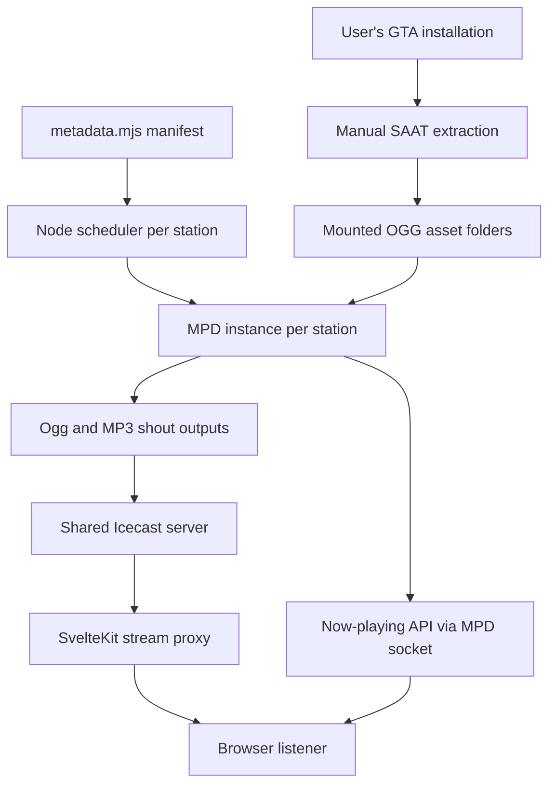

# Zoya Radio — RadioSanAndreas Repository Research

**Research date:** 9 August 2026  
**Repository:** [bedro0/RadioSanAndreas](https://github.com/bedro0/RadioSanAndreas)  
**Primary snapshot:** default `main` branch at commit [`fced3dc9728a9ab658ad893369ac81ef3ccee017`](https://github.com/bedro0/RadioSanAndreas/tree/fced3dc9728a9ab658ad893369ac81ef3ccee017), dated 12 November 2025  
**Later branch inspected:** `dev` at [`c315704ae41303a63390724e4d4eeff21880a7a6`](https://github.com/bedro0/RadioSanAndreas/tree/c315704ae41303a63390724e4d4eeff21880a7a6), dated 17 December 2025  
**Purpose:** architectural research only. No Zoya Radio code, roadmap, project-state document, milestone, or acceptance status was changed.

## Evidence discipline

This report uses three explicit evidence levels:

- **Demonstrated:** directly visible in repository code, configuration, history, or issues at the pinned commits.
- **Inference:** the most reasonable architectural explanation of demonstrated facts, labelled as such.
- **Unknown / not demonstrated:** the repository does not contain enough evidence to support the claim.

Repository files are linked to the pinned `main` commit wherever practical. Later-branch findings are identified as `dev`; they must not be mistaken for behavior present on the default branch.

No source code, GTA dialogue, jokes, advertisements, lyrics, station scripts, or other creative content is reproduced here. Function and category names are mentioned only to explain architecture.

---

## 1. Executive summary

### The short answer

**Demonstrated:** RadioSanAndreas is a small, self-hosted internet-radio system that takes audio files manually extracted from a user's GTA: San Andreas installation, arranges them with a custom JavaScript scheduler, plays them through one Music Player Daemon instance per station, sends each station to Icecast, and exposes the live streams through a SvelteKit website.

It is **not** merely one long MP3 per station, and it is **not** a recovered implementation of Rockstar's original procedural radio algorithm.

Its most important genuinely modular behavior is this:

1. Each music track is represented as a linked bundle: several possible intro files, one fixed middle file, and several possible outro files.
2. The scheduler selects the song as one unit, randomly chooses one of its intro variants and one of its outro variants, and queues `intro → middle → outro` together.
3. Separate pools hold generic DJ material, callers, IDs, weather lines, and time-of-day lines.
4. A simple weighted category selector places one or two non-song modules between songs.
5. A bounded-random queue delays repeats while allowing the order to evolve.

The author explicitly states that they do not know how the game itself schedules these assets and instead created their own radio-like behavior. That admission is crucial: this repository is an **independent reconstruction using GTA's modular assets**, not evidence of GTA's internal clock. See the project's [own architectural explanation](https://github.com/bedro0/RadioSanAndreas/blob/fced3dc9728a9ab658ad893369ac81ef3ccee017/sveltekit/src/routes/about/%2Bpage.svelte#L27-L71).

### Most valuable lessons for Zoya Radio

**Directly or partially relevant:**

- Separate content identity from scheduling logic.
- Represent a complex prepared item as an ordered bundle that the scheduler cannot accidentally split.
- Keep simple anti-repeat state outside the creative material.
- Use deterministic context to select from valid material.
- Pre-queue the complete next unit before it becomes audible.
- Ask the authoritative playback engine for current item and position instead of guessing from the user interface.
- Preserve music bodies by making safe insertion zones structural.

### Most important limits

**Demonstrated absences:**

- no runtime audio mixer;
- no ducking, dynamic volume riding, crossfade, or speech-over-music assembly;
- no semantic relationship engine between generic DJ lines and songs;
- no intro-duration or vocal-entry metadata;
- no multi-song music sweeps;
- no separate host, imaging, caller, and commercial clocks;
- no commercial pods on music stations;
- no durable station or listener memory;
- no listener-specific programming;
- no Safe Playback equivalent;
- no original Rockstar scheduling code.

The system sounds more sophisticated than its scheduler because many song-edge assets are already produced variants containing the desired DJ/music relationship. The transition artistry is mostly **inside the source files**, not created by the repository at runtime.

### Bottom-line value

This is a **useful reference for asset taxonomy, bounded randomness, prepared bundles, and broadcast plumbing**. It is a **weak reference for Zoya Radio's future creative direction, opportunity analysis, safe interaction with external playback, mixing, memory, or production clocks**. Its strongest lesson is not “copy this scheduler.” It is that a modest deterministic controller can create meaningful variety when its content units are carefully classified—and that poor clock design remains poor clock design no matter how many clever audio files sit behind it.

---

## 2. What the repository actually does

### Demonstrated end-to-end behavior

The repository requires the user to:

1. own or have access to an installed PC copy of GTA: San Andreas;
2. run the bundled/referenced San Andreas Audio Toolkit manually;
3. export the game's radio audio into a working directory;
4. mount that directory into the Docker container at `/radiosa/music`;
5. build and run a container that starts Icecast, one MPD process per enabled station, one scheduler process per station, and a SvelteKit web application.

The manual extraction and volume-mount instructions are in the [README](https://github.com/bedro0/RadioSanAndreas/blob/fced3dc9728a9ab658ad893369ac81ef3ccee017/README.md#L4-L18). The Docker image itself copies only the web app, configuration, and scripts; it does not copy or run the extraction toolkit ([Dockerfile](https://github.com/bedro0/RadioSanAndreas/blob/fced3dc9728a9ab658ad893369ac81ef3ccee017/Dockerfile#L1-L26)).

### What is procedural here

**Demonstrated:** The order of songs and interstitial categories is generated at runtime. Individual song intros and outros are also selected at runtime. Pools are shuffled at process start and then mutated as items are chosen. Weather and time announcements can be selected according to current external conditions.

### What is not procedural here

**Demonstrated:** The creative audio itself is fixed. The repository does not generate host speech, write scripts, synthesize voices, remix assets, or construct advertisements. It selects among already-produced files.

**Demonstrated:** A song's middle is fixed. Its available intros and outros are explicitly listed in metadata. A talk show is a fixed three-file sequence. A commercial is one fixed file. Generic DJ material is one fixed file per item.

### Does it reconstruct GTA's original radio algorithm?

**No.** The repository's own About page says the author has no knowledge of how the game treats the files and is strategically reverse-engineering a radio-like result. The custom queue algorithm is documented as the author's solution, including the author's own name for it, “Randomized Dual-Head Queue” ([About page](https://github.com/bedro0/RadioSanAndreas/blob/fced3dc9728a9ab658ad893369ac81ef3ccee017/sveltekit/src/routes/about/%2Bpage.svelte#L48-L74); [queue explanation](https://github.com/bedro0/RadioSanAndreas/blob/fced3dc9728a9ab658ad893369ac81ef3ccee017/sveltekit/src/routes/rdhq/%2Bpage.svelte#L49-L80)).

**Inference:** The project is best described as an original automation layer over extracted, already-produced GTA radio modules.

---

## 3. Architecture map

### Component responsibilities

| Component | Demonstrated responsibility | What it does not do |
|---|---|---|
| San Andreas Audio Toolkit | Manually extracts radio files from the installed game before the server runs. | No runtime role; no scheduling. |
| `metadata.mjs` | Defines station identity, asset paths, song bundles, and category pools. | No playback; no automatic classification; no duration or semantic graph. |
| `control-mpd-playback.mjs` | Chooses categories and assets, maintains short-term in-memory repeat state, and adds paths to MPD. | No decoding, mixing, streaming, UI, durable memory, or creative generation. |
| MPD | Holds and consumes the playback queue, decodes files, reports duration/current status, and emits encoded station audio. | It does not decide editorial order; it plays the queue the Node script supplies. |
| Icecast | Receives each MPD output and exposes persistent station mountpoints to listeners. | It does not choose content or create transitions. |
| SvelteKit | Lists enabled stations, proxies Icecast audio, displays now-playing data, and provides browser controls. | It is not the station scheduler. |
| Docker/start script | Packages dependencies and launches the group of services consistently. | It contributes no radio intelligence. |

### Startup and process topology

**Demonstrated:** `start.sh` prepares runtime directories, rewrites configuration templates, starts one Icecast process, then loops through enabled station aliases. For every station it generates an MPD configuration, starts an MPD instance, and starts a Node scheduler in the background. Finally it runs the SvelteKit Node server ([`start.sh`](https://github.com/bedro0/RadioSanAndreas/blob/fced3dc9728a9ab658ad893369ac81ef3ccee017/scripts/start.sh#L3-L47)).

**Demonstrated:** Each MPD instance uses a station-specific Unix socket and publishes two Icecast sources, one Ogg and one MP3, at station-specific mountpoints. Both are transcoded at 32 kHz stereo and configured for 240 kbit/s ([MPD template](https://github.com/bedro0/RadioSanAndreas/blob/fced3dc9728a9ab658ad893369ac81ef3ccee017/config/sample.conf#L1-L33)).

**Demonstrated:** The website normally proxies Icecast through `/api/radio`, so port 8000 does not need to be exposed publicly. The browser receives the already-running station rather than controlling MPD directly ([stream proxy](https://github.com/bedro0/RadioSanAndreas/blob/fced3dc9728a9ab658ad893369ac81ef3ccee017/sveltekit/src/routes/api/radio/%2Bserver.js#L1-L30)).

### Broadcast semantics

**Demonstrated:** One station process produces one shared stream. Every listener to that station hears the same live sequence. Joining behaves like tuning into a transmitter already on air; it does not create a personal queue.

**Demonstrated:** Browser pause affects only that listener. The station continues. On playback/reconnection the frontend refreshes its stream URL with a cache-busting value, which is intended to rejoin the live source rather than resume an old buffered position ([station player](https://github.com/bedro0/RadioSanAndreas/blob/fced3dc9728a9ab658ad893369ac81ef3ccee017/sveltekit/src/routes/%5Bchannel%5D/%2Bpage.svelte#L29-L57)).

**Comparison:** This is the opposite of Zoya Radio's intended one-listener architecture. RadioSanAndreas is one programme feeding many listeners; Zoya observes and accompanies one listener's independently controlled music.

---

## 4. Audio-asset organization

### Extraction and storage

**Demonstrated:** The actual station OGG files are not committed to the repository. The user exports them and mounts the resulting directory. Paths in `metadata.mjs` assume station folders and a shared advert folder under that mounted root.

**Demonstrated:** The repository contains a 7z archive of the extraction toolkit, but no runtime script invokes it. Extraction is a separate, manual preparation stage.

**Inference:** This design avoids distributing the main body of licensed station audio and keeps the container reproducible without embedding a user's game files. The repository does include some small interface/radio-static sounds and branded image assets; those are separate from the large extracted station library.

### The manifest

**Demonstrated:** The default branch stores its complete station catalogue in a 2,990-line JavaScript module, [`scripts/metadata.mjs`](https://github.com/bedro0/RadioSanAndreas/blob/fced3dc9728a9ab658ad893369ac81ef3ccee017/scripts/metadata.mjs). There is no current generator, scanner, database, schema validator, or automatic filename classifier.

**Inference:** The classification appears manually curated. Filenames carry human-readable type markers, but the core scheduler trusts the manifest rather than parsing names to infer category or relationship.

### Station identity fields

Each music-station object carries:

- channel name;
- asset-folder name;
- genre;
- fictional location;
- proposed real-world analogue;
- host name;
- latitude and longitude used by weather selection;
- a logging colour.

The structure is visible at the start of the [Bounce FM definition](https://github.com/bedro0/RadioSanAndreas/blob/fced3dc9728a9ab658ad893369ac81ef3ccee017/scripts/metadata.mjs#L1-L11). The `dev` branch later separates these fields into `Identity` and the asset pools into `Content`; that improves organization but does not change the radio-generation model.

### Song model

Each song object contains:

- `intros`: one to three candidate intro files;
- `mid`: exactly one middle file;
- `outros`: one to three candidate outro files.

Most stations expose a plain intro/outro plus two variants whose filenames identify DJ-bearing versions. The first song definition demonstrates the shape without requiring the scheduler to understand the audio's words ([metadata lines 11–24](https://github.com/bedro0/RadioSanAndreas/blob/fced3dc9728a9ab658ad893369ac81ef3ccee017/scripts/metadata.mjs#L11-L24)).

**Demonstrated consequence:** Individual song edges are rearrangeable, but the middle remains attached to the correct song. The scheduler cannot accidentally put one song's intro on another song because it selects the containing object first.

### Measured manifest inventory

The following counts were derived by traversing every OGG path in the pinned `main` manifest. They describe references in the manifest, not a verified inventory of the user's extracted folder.

| Category | Logical units | File references | Notes |
|---|---:|---:|---|
| Songs | 151 song objects | 992 | 424 intro variants + 151 fixed middles + 417 outro variants |
| DJ-bearing song edges | — | 571 | 289 intro variants + 282 outro variants identified by their filename convention |
| Plain song edges | — | 270 | 135 intro variants + 135 outro variants |
| Generic caller modules | 21 | 21 | Absent from K-JAH and Radio Los Santos; very small pools |
| Generic DJ modules | 211 | 211 | Some files labelled as stories are stored in this same scheduler category |
| Station IDs | 95 | 95 | No separate jingle/stinger data type |
| Weather modules | grouped by condition | 64 | Music stations only; SFUR has no Weather pool |
| Time-of-day modules | grouped by day part | 63 | Music stations only |
| Bridge announcements | 30 | 30 | Three per music station; excluded from playback |
| WCTR shows | 31 show bundles | 93 | Each bundle has intro, middle, and outro; news episodes are also treated as Show |
| WCTR adverts | 69 adverts | 69 | Individual files; WCTR only |
| **Total** | — | **1,638 unique paths** | No duplicate path occurs in the manifest |

### Per-station pool sizes

Weather and time columns count referenced files, while Song/Caller/DJ/ID/Show/Advert count logical selectable units.

| Station alias | Songs | Caller | DJ | ID | Weather files | Time files | Show | Advert |
|---|---:|---:|---:|---:|---:|---:|---:|---:|
| `bouncefm` | 17 | 3 | 32 | 8 | 7 | 7 | — | — |
| `csr` | 12 | 2 | 15 | 8 | 6 | 5 | — | — |
| `kdst` | 17 | 3 | 12 | 11 | 6 | 8 | — | — |
| `kjah` | 16 | — | 26 | 10 | 7 | 6 | — | — |
| `krose` | 15 | 2 | 25 | 9 | 7 | 4 | — | — |
| `mastersounds` | 16 | 5 | 27 | 8 | 6 | 6 | — | — |
| `playbackfm` | 12 | 2 | 16 | 11 | 8 | 6 | — | — |
| `radiols` | 15 | — | 20 | 11 | 10 | 6 | — | — |
| `radiox` | 15 | 2 | 17 | 11 | 7 | 6 | — | — |
| `sfur` | 16 | 2 | 21 | — | — | 9 | — | — |
| `wctr` | — | — | — | 8 | — | — | 31 | 69 |

### Categories that do and do not exist

**Demonstrated:**

- Songs, generic DJ material, caller material, IDs, weather, time-of-day, shows, and adverts can be separate scheduler categories.
- News exists only as show bundles under WCTR; there is no general News category.
- Story-labelled files are placed inside DJ pools; Story is not a scheduler category.
- There is no explicit jingle, stinger, promo, sweeper, liner, or commercial-pod category.
- Bridge announcements exist in metadata but are intentionally excluded by the scheduler's category filter.
- Advert is present only for WCTR. Music stations do not receive adverts from this implementation.

### Relationship metadata

**Demonstrated:** The manifest encodes only one strong semantic relationship: which intros, middle, and outros belong to the same song or show. Generic DJ, caller, ID, weather, time, and advert files are not linked to particular previous or next songs.

**Demonstrated:** There are no fields for:

- previous-song compatibility;
- next-song compatibility;
- mood, energy, topic, or genre transition;
- callback chain;
- intro duration or vocal-entry point;
- safe speech window;
- commercial campaign or pod membership;
- cooldown duration;
- factual provenance;
- listener relevance.

**Unknown:** Some extracted files may internally contain sophisticated transitions, speech/music overlap, or content-specific references. That is an attribute of the audio file, not metadata the repository can inspect or reason about.

---

## 5. Sequencing and radio-generation logic

This is the repository's real programme director.

### Step 1: discover playable categories

**Demonstrated:** The scheduler intersects each station's keys with a fixed allow-list: Song, Caller, DJ, ID, Weather, Time of Day, Show, and Advert. Bridge Announcement is therefore ignored even though it exists in metadata ([category construction](https://github.com/bedro0/RadioSanAndreas/blob/fced3dc9728a9ab658ad893369ac81ef3ccee017/scripts/control-mpd-playback.mjs#L17-L24)).

### Step 2: calculate category weights

**Demonstrated:** Each ordinary array category receives a weight equal to the square of its pool length. Weather and Time of Day are objects without a length, so they receive weight 1. The weight is an editorial category-selection weight, not an individual-item weight and not an airtime percentage.

Examples:

| Station | Category weights before conditional exclusions |
|---|---|
| K-Rose | Song 225; Caller 4; DJ 625; ID 81; Weather 1; Time 1 |
| K-DST | Song 289; Caller 9; DJ 144; ID 121; Weather 1; Time 1 |
| WCTR | Show 961; ID 64; Advert 4,761 |

**Interpretation:** Squaring pool length was added because small caller pools were recurring too frequently; the commit says so ([weight change, 24 September 2025](https://github.com/bedro0/RadioSanAndreas/commit/0c6fdda96a451a61dc99590b7dca9b54ddcb5eb0)). It reduces the *category's* chance as a side effect of having fewer available assets.

**Important limitation:** Inventory size and desired editorial frequency are different concepts. In this design, adding ten new caller clips automatically makes callers dramatically more frequent even if the desired caller clock did not change.

### Step 3: shuffle each pool once

**Demonstrated:** At process start, each array pool is shuffled once, except Weather and Time of Day. The arrays then become mutable scheduling state ([startup shuffle](https://github.com/bedro0/RadioSanAndreas/blob/fced3dc9728a9ab658ad893369ac81ef3ccee017/scripts/control-mpd-playback.mjs#L26-L33)).

### Step 4: choose the next category

The function `getNextCategory()` applies three rules ([lines 120–137](https://github.com/bedro0/RadioSanAndreas/blob/fced3dc9728a9ab658ad893369ac81ef3ccee017/scripts/control-mpd-playback.mjs#L120-L137)):

1. The immediately previous category cannot repeat.
2. If the previous category was Caller, DJ, Weather, or Time of Day, all four of those “DJ-voiced” categories are temporarily removed. This prevents two such host-voice categories from being selected consecutively.
3. After more than one non-song/non-show selection, the next category is forced to Song or Show.

For a music station, this creates exactly one or two intermediate modules between songs. Consecutive songs are structurally impossible.

Examples under the current weights:

- After a K-Rose song, DJ has about an 87.8% conditional chance, ID about 11.4%, Caller about 0.6%, and valid Weather/Time about 0.1% each.
- After a K-Rose DJ-voiced module, only Song and ID remain; Song is about 73.5% and ID about 26.5%.
- After a K-DST song, DJ is about 52.2%, ID about 43.8%, Caller about 3.3%, and Weather/Time about 0.4% each.
- After two intermediate modules, probability no longer matters: Song is forced.

These are conditional selection probabilities, not measured airtime. Clip durations can differ greatly.

### Step 5: choose an item within the category

**Demonstrated:** `getRandomBitTrack()` chooses either the first or second item in the mutable category array with equal probability, removes it, and appends it to the end ([lines 139–146](https://github.com/bedro0/RadioSanAndreas/blob/fced3dc9728a9ab658ad893369ac81ef3ccee017/scripts/control-mpd-playback.mjs#L139-L146)).

The author documents this as a compromise between a fixed rotation and fully independent random draws. For a pool of size `n`, an item moved to the end cannot become one of the first two candidates again until at least `n−2` other selections from that pool have occurred. The [project's illustrated explanation](https://github.com/bedro0/RadioSanAndreas/blob/fced3dc9728a9ab658ad893369ac81ef3ccee017/sveltekit/src/routes/rdhq/%2Bpage.svelte#L49-L80) describes the same guarantee.

**Important edge case:** A two-item pool has `n−2 = 0`; it can select the same clip again the next time that category occurs. Several caller pools contain only two items. Category spacing makes the repeat less immediate in wall-clock terms, but the item algorithm itself provides no meaningful cooldown for a two-item pool.

### Step 6: expand composite items

`getNextTrack()` returns different shapes by category ([lines 77–118](https://github.com/bedro0/RadioSanAndreas/blob/fced3dc9728a9ab658ad893369ac81ef3ccee017/scripts/control-mpd-playback.mjs#L77-L118)):

- **Song:** one randomly chosen intro + fixed middle + one randomly chosen outro.
- **Show:** the selected show's existing intro/middle/outro array.
- **Weather/Time:** one context-selected file or null.
- **All others:** one selected file.

If Weather or Time cannot produce a valid file, that category is removed for this selection attempt and the scheduler tries again.

### Step 7: queue and play

**Demonstrated:** Every path in the selected unit is added to MPD before playback proceeds. MPD's consume mode removes played entries, preventing an ever-growing history in its live queue. The controller then sleeps according to the full durations of queued items after the currently first item ([queue loop and `remainingTime`](https://github.com/bedro0/RadioSanAndreas/blob/fced3dc9728a9ab658ad893369ac81ef3ccee017/scripts/control-mpd-playback.mjs#L35-L69)).

**Inference:** This is a queue-horizon mechanism, not an event scheduled precisely at the next file's final sample. It keeps future material waiting in MPD while avoiding constant polling. MPD, not Node timers, performs the actual continuous playback.

### Is it a fixed playlist?

**No.** Category and item order evolve probabilistically.

### Is it a radio clock?

**Only in a limited sense.** It has category-spacing rules and a forced return to music, but no hour structure, minute positions, quota windows, dayparts beyond contextual line selection, or separately budgeted host/ad/imaging rates.

### Does MPD contain the sequencing intelligence?

**No.** MPD receives file paths in the chosen order. The intelligence lives in `control-mpd-playback.mjs` plus the relationships encoded in `metadata.mjs`.

### Explicitly absent sequencing features

The default branch contains no demonstrated implementation of:

- a fixed canonical station playlist;
- seeded/replayable random sessions;
- weighted individual assets;
- time-since-last-play in minutes or songs outside the dual-head queue order;
- separate recent-history lists;
- semantic song-to-song segues;
- rules connecting generic DJ lines to a particular previous or next song;
- ad campaigns, ad pods, or variable pod sizes;
- multi-song sweeps;
- explicit opening, closing, top-of-hour, or station-reset clocks;
- listener preference or skip response;
- persistent station state;
- adaptive anti-annoyance logic;
- AI or generative creativity.

---

## 6. Timing and transition behavior

### What timing information exists

**Demonstrated:** Duration is not stored in the manifest. Once files are in MPD, the controller reads each queued track's `duration` property to decide how long to wait before replenishing the queue.

**Demonstrated:** The now-playing API asks MPD for the current song and status, then calculates remaining time from MPD's `duration − elapsed` values. The browser uses that result to schedule its next metadata poll ([now-playing endpoint](https://github.com/bedro0/RadioSanAndreas/blob/fced3dc9728a9ab658ad893369ac81ef3ccee017/sveltekit/src/routes/api/now-playing/%2Bserver.js#L1-L20); [browser polling](https://github.com/bedro0/RadioSanAndreas/blob/fced3dc9728a9ab658ad893369ac81ef3ccee017/sveltekit/src/routes/%5Bchannel%5D/%2Bpage.svelte#L58-L75)).

### What timing information does not exist

**Demonstrated absence:** The code has no representation of:

- vocal start;
- instrumental intro length;
- safe talk-up endpoint;
- outro/fade start;
- beat or phrase boundary;
- silence region;
- speech occupancy inside a file;
- transition compatibility;
- pre-roll/post-roll;
- ad-copy end versus produced-module end.

### Mixing, ducking, fading, and overlap

**Demonstrated:** No MPD crossfade, mixramp, replay-gain transition rule, or mixer/filter configuration is present. No JavaScript code alters gain or overlaps two live sources. No history commit introduces those features.

**Demonstrated:** Files are queued sequentially. Song intro/middle/outro assets are already separate encoded audio files.

**Inference with high confidence:** Any host-over-intro, host-over-outro, ducking, fades, sonic stings, or internal mixing heard inside a selected song-edge variant is baked into that extracted file. RadioSanAndreas selects a produced version; it does not construct the mix.

### Next-item preparation and buffering

**Demonstrated:** Composite units are fully queued before their first component finishes, and the scheduler replenishes MPD before the queue empties. MPD and Icecast handle decoding, encoding, client buffering, and stream delivery.

**Partially relevant to Zoya:** The general principle—prepare a complete complex unit before its first audible beat—is useful. The specific mechanism is not: Zoya controls an external music source and needs a separate mixer/safety layer rather than handing the whole programme to MPD.

### Implication for seamlessness

**Unknown:** Without the user's extracted OGG files and a captured output stream, this code review cannot prove sample-accurate joins, quantify gaps, or measure the internal fades/ducking of edge variants.

**Demonstrated:** The repository contains no explicit code to repair a poorly cut boundary. Seamlessness depends on the extracted assets and MPD's sequential decoding/output behavior.

---

## 7. Commercial, imaging, and interstitial handling

### Music stations

**Demonstrated:** No music-station metadata object includes an Advert pool. The scheduler therefore cannot insert commercials on Bounce FM, CSR, K-DST, K-JAH, K-Rose, Master Sounds, Playback FM, Radio Los Santos, Radio X, or SFUR.

**Demonstrated:** Those stations can insert:

- generic DJ modules;
- callers where available;
- station IDs where available;
- weather lines where available and valid;
- time-of-day lines where available and valid.

At least one such module is required between songs. IDs are a distinct category, but there is no guarantee that an ID appears at any specific boundary.

### WCTR

**Demonstrated:** WCTR contains 31 Show bundles, 8 IDs, and 69 individual Advert files ([WCTR definition](https://github.com/bedro0/RadioSanAndreas/blob/fced3dc9728a9ab658ad893369ac81ef3ccee017/scripts/metadata.mjs#L2743-L2758); [ID/Advert pools](https://github.com/bedro0/RadioSanAndreas/blob/fced3dc9728a9ab658ad893369ac81ef3ccee017/scripts/metadata.mjs#L2909-L2989)).

The same category rules apply:

- an Advert cannot follow another Advert;
- after two non-show modules, Show is forced;
- there is no pod object or campaign state.

Given the current weights:

- after a Show, Advert is approximately 98.7% versus ID at 1.3%;
- after an Advert, Show is approximately 93.8% versus ID at 6.2%;
- a two-step interstitial sequence is possible, after which Show is forced.

**Interpretation:** The dominant WCTR grammar is probabilistically `Show → one Advert → Show`. It is not a one-or-two-ad pod system. Back-to-back advertisements are structurally prohibited.

### Comparison with the V-Rock findings

The V-Rock production audit measured:

- eight ads in six pods;
- four single-ad and two double-ad pods;
- DJ or imaging around some pods;
- direct music return after some pods;
- two direct two-song sweeps;
- a planned two-songs → ad midpoint → two-songs macro-block.

RadioSanAndreas does **not** reproduce those concepts:

| V-Rock production behavior | RadioSanAndreas code evidence |
|---|---|
| Variable one- and two-ad pods | Not implemented; Advert cannot repeat consecutively. |
| Commercials on a music station | Not implemented; Advert exists only on WCTR. |
| DJ/imaging independently placed around a pod | Not explicitly planned; ID and Advert compete in one category selector. |
| Direct return from ad to music | Not applicable to music stations; WCTR usually returns from ad to Show. |
| Imaging sometimes replaces DJ | Partially analogous: ID is a standalone category, but it is not an explicit boundary-role substitution. |
| Direct two-song sweep | Impossible; Song cannot follow Song. |
| Four-song macro-block | Not implemented. |
| Separate host/ad/imaging clocks | Not implemented; one conditional weight system chooses all categories. |

### Imaging and sonic identity

**Demonstrated:** IDs are separate files and can recur through the bounded-random queue. This supports a stable identity layer at low runtime complexity.

**Not demonstrated:** The code does not know whether an ID is a dry liner, full jingle, stinger, sonic logo, or host-delivered statement. All are just paths in the ID pool.

**Implication:** The repository demonstrates the utility of typed imaging inventory, but not a production-aware imaging scheduler.

---

## 8. State, randomness, and repetition handling

### Station-wide runtime state

**Demonstrated:** Each station scheduler holds three relevant forms of in-memory state:

1. the mutated order of every category array;
2. `lastCategory`;
3. a counter of how many non-song/non-show categories have occurred since music/show.

MPD separately holds the currently playing file and future queue.

### Persistence

**Demonstrated absence:** No database or state file stores scheduler history, array order, last category, random seed, previous selection, or session identity. Restarting the Node scheduler reconstructs and reshuffles the pools.

**Demonstrated:** The browser persists only volume in `localStorage`; that is listener UI state, not station programming state ([player state](https://github.com/bedro0/RadioSanAndreas/blob/fced3dc9728a9ab658ad893369ac81ef3ccee017/sveltekit/src/routes/%5Bchannel%5D/%2Bpage.svelte#L19-L27)).

### Random seed

**Demonstrated:** The code constructs a Chance instance without supplying or storing a seed. The repository therefore provides no way to replay a particular generated station sequence from a recorded seed.

### Repeat avoidance

**Demonstrated strengths:**

- an item in a large pool cannot immediately repeat;
- a selected song moves to the back of the song pool;
- the category itself cannot repeat immediately;
- several host-voiced categories are mutually blocked for one step;
- category order gradually changes rather than repeating one complete shuffle.

**Demonstrated limitations:**

- two-item pools can repeat the same item on their next category occurrence;
- intro and outro choices are independent random draws each time a song returns, with no variant history;
- there is no time-based cooldown;
- generic semantic repetition is not detected;
- two distinct files expressing the same joke or theme are treated as unrelated;
- no durable history survives restart;
- category frequency changes when pool size changes.

### Listener and session state

**Demonstrated absence:** The scheduler does not know who is listening, how long they have listened, what they skipped, what they like, or what they heard yesterday.

### Predictability

**Interpretation:** The station is neither fixed nor deeply adaptive. It is a constrained stochastic stream. Short-range shape is predictable—music, one or two interstitials, music—while exact assets and song order vary.

---

## 9. Technologies and dependencies

The repository packages the stack in one Docker image ([Dockerfile](https://github.com/bedro0/RadioSanAndreas/blob/fced3dc9728a9ab658ad893369ac81ef3ccee017/Dockerfile#L1-L35)).

| Technology | Ordinary-language role | Why it appears to be used | Relevance to Zoya Radio |
|---|---|---|---|
| Node.js | Runs the station scheduler and the web server. | One language can control MPD, fetch weather/time, manipulate metadata, and serve the site. | **Partially relevant:** general orchestration concepts, not necessarily the runtime choice. |
| Chance | Supplies shuffle, weighted choice, booleans, and random picks. | Convenience around constrained randomness. | **Directly relevant principle:** bounded randomness; package itself is not important. |
| MPD | A headless/server-side music player controlled by commands. Officially, MPD is a server-side playback application controlled through a protocol ([MPD](https://www.musicpd.org/)). | Reliable queueing, decoding, duration/status reporting, consume mode, and stream-source output. | **Partially relevant:** authoritative playback state and prequeueing are useful ideas; Zoya should not replace the listener's external music source with MPD. |
| `mpc-js` | JavaScript client library used to command MPD over Unix sockets. | Lets each Node scheduler add files and read playback state. | **Not directly relevant:** adapter-specific plumbing. |
| Icecast | The transmitter: it accepts source audio and serves it to multiple listeners. Icecast describes itself as a streaming media server for internet radio or private jukebox use ([Icecast](https://icecast.org/)). | Turns each MPD output into an always-running Ogg/MP3 station endpoint. | **Not relevant** to a single-listener local companion unless Zoya later adds optional household broadcasting. |
| SvelteKit/Svelte 5 | Builds the browser interface and server API/proxy. The project uses `adapter-node` to produce a standalone Node server ([SvelteKit Node adapter](https://svelte.dev/docs/kit/adapter-node)). | Station picker, live audio element, now-playing display, Media Session integration, proxy endpoints. | **Mostly not relevant** to the present Windows UI; frontend/backend separation remains a useful general concept. |
| Docker | Packages Node, MPD, Icecast, configuration, and the app into one reproducible environment. Docker describes containers as isolated, self-contained processes ([Docker containers](https://docs.docker.com/get-started/docker-concepts/the-basics/what-is-a-container/)). | Makes a complicated Linux service stack installable with one build/run recipe and a mounted music directory. | **Not relevant** to Zoya's core local Windows operation; likely unnecessary complexity. |
| Open-Meteo | Supplies current weather code for the station's assigned coordinates. | Enables context-valid pre-recorded weather lines. | **Interesting but future:** deterministic context is useful; network dependence should remain optional. |
| WorldTimeAPI | Supplies Pacific time and daylight-saving data. | Selects pre-recorded daypart lines and avoids sunny announcements at night. | **Partially relevant:** local system time is simpler and more reliable for Zoya. |
| Ogg/MP3 outputs | Two browser-compatible stream formats. | MP3 was made the preferred format for Apple/WebKit compatibility in a later commit. | **Not relevant:** Zoya is not distributing a web stream. |

### Essential versus convenience

- **Essential to this repository's radio generation:** metadata manifest, Node scheduler, an audio queue/player.
- **Essential to its multi-listener broadcast:** Icecast and MPD's shout outputs.
- **Essential to its web experience:** SvelteKit and browser audio.
- **Deployment convenience:** Docker and startup templating.
- **Optional enrichment:** weather and time APIs.

The full broadcast stack is not evidence that Zoya needs the same stack. RadioSanAndreas solves distribution; Zoya's hard problems are observation, timing, restraint, safety, prepared voice, and interaction with someone else's playback.

---

## 10. Error and failure behavior

### Missing audio files

**Demonstrated:** The main scheduler does not preflight the manifest against the mounted music directory. Adding a missing or invalid path to MPD is awaited without a surrounding recovery block. A rejected add can terminate that station's Node scheduler.

**Demonstrated:** The About-page single-file endpoint checks existence and returns 404, but that check belongs to the demo API, not the station scheduler ([`getTrack` endpoint](https://github.com/bedro0/RadioSanAndreas/blob/fced3dc9728a9ab658ad893369ac81ef3ccee017/sveltekit/src/routes/api/getTrack/%2Bserver.js#L1-L16)).

### Weather and time services

**Demonstrated on default `main`:** Weather fetch errors can return a null choice that causes the current category to be removed and retried. The time fetch catches to null but then immediately dereferences the null result, so a failed time service can crash the scheduler ([time/weather code](https://github.com/bedro0/RadioSanAndreas/blob/fced3dc9728a9ab658ad893369ac81ef3ccee017/scripts/control-mpd-playback.mjs#L148-L197)).

**Relevant history:** Issue [#13](https://github.com/bedro0/RadioSanAndreas/issues/13) reported individual station audio stopping while other stations remained healthy. Commit [`d0f9e23`](https://github.com/bedro0/RadioSanAndreas/commit/d0f9e2321fccc1c2479dfc4d6ec8bf927a94cc27) on `dev` added broader null/error handling and was credited with resolving the backend playback problem. That commit is **not contained in the default `main` branch** at the research snapshot.

### Service crashes and supervision

**Demonstrated:** Icecast and each scheduler are launched as background processes by a shell script. There is no process supervisor, health check, automatic per-service restart, or watchdog in the repository. The README's `docker run` example does not define a Docker restart policy.

**Implication:** A station scheduler can die while the container and website remain alive. MPD may continue until its existing queue drains, after which the station can fall silent.

### Disconnected listeners

**Demonstrated:** A client disconnect does not alter station state. Icecast continues serving the source; the browser can request a fresh URL to rejoin. This is appropriate broadcast behavior.

### Browser autoplay

**Demonstrated:** The player tries to play a tuning-static file during page mount and then start the stream. Open issue [#14](https://github.com/bedro0/RadioSanAndreas/issues/14) documents modern browser autoplay rejection when the page has not received a user gesture. The issue remained open at the research date.

### Stream proxy

**Demonstrated:** The SvelteKit radio proxy catches connection exceptions, but it does not validate station/format values or propagate a non-success Icecast status; it constructs a response with status 200 when `fetch` itself succeeds. Error handling is basic.

### Configuration robustness

**Demonstrated:** Startup performs little validation of enabled station aliases, manifest shape, directories, or generated configuration before launching services.

**Demonstrated inconsistency:** The README says absent Icecast passwords default to random 16-character strings. The implementation randomizes only when the environment value is the empty string, not when it is undefined. With the Dockerfile's defaults, unset password variables can be replaced by the literal JavaScript value `undefined` in both source and server configurations ([password templating](https://github.com/bedro0/RadioSanAndreas/blob/fced3dc9728a9ab658ad893369ac81ef3ccee017/scripts/update-icecast-config.mjs#L7-L27)). This is a robustness/security defect, not a radio-design feature.

### Safe Playback comparison

RadioSanAndreas owns the entire station transport. There is no separate human-controlled music session whose intent must win. Consequently, it has no analogue for Zoya's revalidation rules—discard on track change, pause, Silent Mode, ambiguous target, missed timing, or user action.

**Conclusion:** Its failure model is acceptable for a hobby broadcast experiment but insufficient as a reference for Zoya's safety layer.

---

## 11. Code quality and project maturity

### Activity snapshot

**Demonstrated at research date:**

- repository created 16 February 2024;
- 123 commits reachable from default `main`;
- 131 commits on `dev`;
- default `main` last changed 12 November 2025;
- `dev` last changed 17 December 2025;
- no releases or tags;
- one open issue;
- approximately 17 stars and one fork;
- repository is public and not marked archived.

These popularity counts are time-sensitive and should not be treated as architectural evidence.

### Strengths

- The core scheduler is small enough to understand fully.
- Asset data, scheduling, playback, streaming, and UI are recognizably separate concerns.
- The author documents the queue's design goal and trade-off rather than pretending it is pure randomness.
- Song and show bundles preserve internal order cleanly.
- MPD consume mode avoids an accumulating played-track backlog.
- The history shows iterative responses to real repetition, compatibility, and failure problems.
- The later `dev` branch improves metadata separation and server-side validation.

### Weaknesses and shortcuts

- No automated tests, test fixtures, CI workflow, or schema validation are present.
- The 2,990-line manifest is hard-coded and apparently hand-maintained.
- Category inventory size doubles as editorial weight.
- Several services run inside one container without supervision.
- Dependency and OS versions are not fully pinned; the Dockerfile uses a floating Node 22 image and runs `npm update` during build.
- Runtime startup mutates configuration files in place.
- The default branch lags later fixes on `dev`.
- Error handling is selective rather than systematic.
- The default-branch demo endpoint accepts a user-supplied filesystem-relative track path; the later `dev` branch replaces it with a category-validated server-side selector.
- No durable state or operational observability exists beyond logs and Icecast's interface.

### Maturity assessment

**Inference:** RadioSanAndreas is a thoughtful, evolving hobby project/prototype rather than production-grade radio automation. It contains deliberate architecture, especially in asset grouping and repeat avoidance, but also practical shortcuts typical of a single-maintainer experiment. “Experimental” is fair; “abandoned” is not established. It had later `dev` work after the default branch, but no commit after December 2025 as of this report.

### Relevant history milestones

| Date | Commit | Architectural significance |
|---|---|---|
| 30 Jun 2024 | [`884ec72`](https://github.com/bedro0/RadioSanAndreas/commit/884ec729cfab37dfedc252bcfb6038af42627e25) | Early queue overhaul; introduces bounded two-head selection in Python and explicit song spacing. |
| 21–25 Sep 2024 | [`de2bdcd`](https://github.com/bedro0/RadioSanAndreas/commit/de2bdcdda9056109f233d4108ee7f84964c1c8b8), [`766180d`](https://github.com/bedro0/RadioSanAndreas/commit/766180da8463cf7c44a5191be4ec18721a5d7140) | Adds weather/time context selection. |
| 14 Oct 2024 | [`f731a0b`](https://github.com/bedro0/RadioSanAndreas/commit/f731a0bb748007efe6814f878bf3739d27b51755) | Adds WCTR shows and adverts. |
| 18 Oct 2024 | [`39daa53`](https://github.com/bedro0/RadioSanAndreas/commit/39daa530d1c9ad7342c8e8a7305787114c01b0ef) | Unifies music and talk scheduling in one JavaScript controller; weights categories by pool size. |
| 24 Sep 2025 | [`0c6fdda`](https://github.com/bedro0/RadioSanAndreas/commit/0c6fdda96a451a61dc99590b7dca9b54ddcb5eb0) | Squares category weights to reduce recurrence of small pools such as callers. |
| 29 Sep 2025 | [`c0c6e71`](https://github.com/bedro0/RadioSanAndreas/commit/c0c6e7162d81b597a82c6ab86cf79dffde6cf272) | Makes MP3 the preferred browser format and raises stream bitrate for compatibility. |
| 28 Oct 2025 | [`f65c37c`](https://github.com/bedro0/RadioSanAndreas/commit/f65c37c456bc80e22391aa1e66a0be540dc61a43) | Converts backend to ES modules and consolidates station metadata. |
| 12 Nov 2025 | [`af88b5c`](https://github.com/bedro0/RadioSanAndreas/commit/af88b5cad8177d40bf1c4e1879628f39e45228ac) | Adds the architectural explanation and asset-category demo. |
| 19 Nov 2025 (`dev`) | [`d0f9e23`](https://github.com/bedro0/RadioSanAndreas/commit/d0f9e2321fccc1c2479dfc4d6ec8bf927a94cc27) | Adds broader weather/time failure handling after station stoppages. |
| 17 Dec 2025 (`dev`) | [`c315704`](https://github.com/bedro0/RadioSanAndreas/commit/c315704ae41303a63390724e4d4eeff21880a7a6) | Moves demo track selection server-side so the client is not given the music directory structure. |

---

## 12. License and reuse boundary

### Software license

**Demonstrated:** The repository's [`LICENSE`](https://github.com/bedro0/RadioSanAndreas/blob/fced3dc9728a9ab658ad893369ac81ef3ccee017/LICENSE) contains the MIT License text. At a high level, it permits using, copying, modifying, merging, publishing, distributing, sublicensing, and selling the software, provided the copyright and permission notice are preserved. It also disclaims warranty.

GitHub's API reports `NOASSERTION`, probably because the file begins with a Markdown heading rather than an exact detector-friendly template. The operative text itself is recognizably MIT.

### What MIT does not solve

The software license cannot grant rights the author does not own in:

- GTA radio recordings;
- licensed songs;
- Rockstar dialogue and advertisements;
- station names and logos;
- GTA visual branding;
- extracted game assets;
- possibly the small game-derived interface sounds committed to the repository.

The README's requirement that users extract their own game files is a practical boundary, not a blanket copyright licence.

### Zoya Radio reuse recommendation

Direct code reuse is unnecessary and undesirable:

- Zoya is not an internet broadcast server.
- Zoya does not own or replace the external music source.
- Zoya requires safe playback validation and richer scheduling state.
- The useful ideas are simple enough to re-express independently: typed modules, bounded repeat avoidance, composite prepared units, and authoritative playback state.

Researching these concepts does not require copying implementation. If any MIT code were ever reused, attribution would be required, but that is outside this research task and not recommended.

---

## 13. Comparison with Zoya Radio and the production research

### First: the architectural mismatch

| RadioSanAndreas | Zoya Radio |
|---|---|
| Owns every audio asset and the entire playback queue. | Observes and safely interacts with an external user-controlled music source. |
| One shared station serves many listeners. | One local station is built around one listener. |
| All spoken content is fixed and pre-recorded. | Host material may be selected, generated, directed, rendered, validated, and discarded. |
| Transitions are mostly baked into extracted edge files. | A future mixer must actively duck, ride, fade, pause, or replace external music. |
| Simple in-memory category state. | Session state, anti-annoyance, listener memory, factual provenance, and Safe Playback matter. |
| No decision about whether a boundary deserves speech; an interstitial is mandatory. | Silence is valid, and opportunities must be earned. |

### Comparison with K-Rose, K-DST, and V-Rock measurements

| Production finding | Repository relationship | Assessment |
|---|---|---|
| All three audited stations preserve established song bodies. | A Song is queued atomically as intro → middle → outro, so no separate category can be inserted inside it. | **Strong structural match.** |
| K-Rose and K-DST mediate every observed song boundary. | Song cannot follow Song; at least one interstitial is mandatory, and many song-edge variants also include DJ material. | **Similar density, different evidence.** The code enforces mediation but does not prove the exact audited compilation clock. |
| K-Rose often talks across incoming intros; K-DST more often launches cleanly. | The scheduler randomly selects pre-produced intro variants but has no style variable controlling incoming overlap. | **Only asset-level approximation.** It cannot reason about overlap style. |
| K-Rose's links are highly previous-song related; K-DST often advances host mythology. | Song-specific edge variants remain attached to their song; generic DJ modules are unrelated random selections. | **Partially relevant taxonomy, no semantic director.** |
| Voice occupancy differs sharply even when every boundary is touched. | Category selection uses pool counts, not clip durations or active-voice time. | **Cannot model the measured difference reliably.** |
| V-Rock allows imaging-only boundaries and direct music sweeps. | ID exists, but Song→Song is prohibited. | **Imaging concept present; sweep grammar absent.** |
| V-Rock separates commercial pods from host cadence. | Only WCTR has adverts, chosen by the same category engine; no pods. | **Does not implement separate clocks.** |
| V-Rock creates a four-song macro-block. | No track-spanning plan or payoff state exists. | **Absent.** |
| Audited stations use ducking/fades/overlap with role-specific sonic treatment. | No runtime mixing; treatments are pre-rendered in files. | **Not a mixer reference.** |
| Callers materially lengthen breaks and need their own clock. | Caller is a distinct category, but its rate is derived from pool size and duration is ignored. | **Useful separation, weak scheduling.** |

### Zoya concept relevance classification

| Zoya concept | Classification | What the repository contributes |
|---|---|---|
| Media Observation | **PARTIALLY RELEVANT** | The now-playing endpoint asks MPD for authoritative current item and elapsed/duration state. RadioSanAndreas does not observe an external player. |
| Session State | **DIRECTLY RELEVANT** | `lastCategory`, non-song counter, and mutable pool order show how tiny deterministic state can shape a stream. Zoya needs richer state. |
| Opportunity Analysis | **NOT RELEVANT / ABSENT** | The repository always schedules a next module; it never asks whether speech is warranted. |
| Scheduling / Anti-Annoyance | **DIRECTLY RELEVANT** | Bounded-random selection and category-spacing are useful patterns. Mandatory interstitials and pool-size-derived cadence are not. |
| Deterministic radio continuity | **DIRECTLY RELEVANT** | Composite song/show bundles and explicit category rules are deterministic structure around random choice. |
| Creative Director | **NOT RELEVANT / ABSENT** | All content is pre-authored; no semantic mode, factual grounding, or creative planning exists. |
| Separate host/imaging/commercial/caller clocks | **PARTIALLY RELEVANT** | Categories are separate inventories, but one selector conflates their clocks. The production research argues for stronger separation. |
| Prepared complex scenes | **DIRECTLY RELEVANT** | A show or song bundle is completely ordered before its first file plays. Future Zoya calls/commercials/chains can use the same principle at a higher level. |
| Audio Engine / Mixer | **PARTIALLY RELEVANT** | MPD supplies queueing and stream encoding, but no runtime scene mixing. Zoya's need is fundamentally different. |
| Safe Playback | **NOT RELEVANT / INSUFFICIENT** | The broadcaster owns transport and has no user-intent revalidation. |
| Station/listener memory | **PARTIALLY RELEVANT** | In-memory pool order creates short-term continuity; no session identity or durable listener memory exists. |
| Local-first operation | **PARTIALLY RELEVANT** | It can self-host locally and keeps audio local, but still runs a Linux broadcast/web stack and optionally depends on two web APIs. |
| Station IDs and sonic branding | **INTERESTING BUT FUTURE** | Separate reusable ID assets demonstrate controlled repetition; unrelated to the active Zoya milestone. |
| Fictional commercials | **INTERESTING BUT FUTURE** | Pre-produced ad files are selectable units, but only on WCTR and without pods or campaigns. |
| Contextual time/weather lines | **INTERESTING BUT FUTURE** | Demonstrates deterministic selection from context-valid variants; local time is more appropriate than a network API for Zoya's core. |
| Intro/middle/outro segmentation | **PARTIALLY RELEVANT** | Excellent when the programme owns stems; Zoya cannot split arbitrary YouTube Music tracks this way. It can still model conceptual edge zones. |
| Internet broadcasting and per-station MPD/Icecast services | **NOT RELEVANT** | Solves a distribution problem Zoya does not currently have. |
| Svelte web tuner | **NOT RELEVANT** | UI-specific to a browser broadcast service. |
| Docker deployment | **NOT RELEVANT** | Adds a Linux service bundle where Zoya needs a lightweight Windows-local companion. |

Nothing in this table promotes a feature into Zoya Radio's approved implementation or near-term roadmap.

---

## 14. Potentially useful ideas

These are research-derived concepts, not implementation decisions.

### 14.1 Typed content manifest — directly relevant

Keep content identity explicit. A scheduler should know whether an item is a song announcement, host comment, ID, caller scene, commercial, weather line, or prepared chain. Filenames alone should not be the long-term schema, but RadioSanAndreas demonstrates the value of separating inventory from playback code.

### 14.2 Composite prepared units — directly relevant

A complex scene can be treated as one schedulable object containing an immutable ordered sequence. Once accepted, internal components cannot be interleaved accidentally. This maps well to future prepared caller scenes, chained comments, IDs plus voice, and commercials.

### 14.3 Bounded randomness — directly relevant

Choosing from a small eligible window at the head of a rotated pool gives variety without the pathological repeats of independent random choice. Zoya could use the principle for pre-rendered IDs, FX, announcer tags, or recurring format variants—combined with real cooldowns and semantic checks.

### 14.4 Editorial cadence must be separate from inventory — directly relevant as a warning

RadioSanAndreas couples them by squaring pool size. Zoya should preserve separate answers to:

- How often may this format occur?
- Which eligible item should be chosen?

Adding more caller assets should improve variety, not automatically make callers take over the station.

### 14.5 Authoritative playback state — directly relevant

The web UI asks MPD what is currently playing and how much time remains. Zoya's Media Observation should likewise supply authoritative facts to scheduling and UI rather than letting generated content infer transport state.

### 14.6 Queue before airtime — directly relevant

The scheduler adds a full song/show bundle before it is needed. Future Zoya complex scenes should be written, voiced, assembled, and validated before the first audible beat.

### 14.7 Context-invalid material can be removed from eligibility — directly relevant

Bridge announcements are excluded because game-progression gates make no sense on a web station. Weather/time selections return no item when context is invalid. The general lesson is sound: possessing an asset does not mean the scheduler should always consider it.

### 14.8 Deterministic context before creative selection — partially relevant

The controller computes time and maps weather codes rather than asking a model to invent the conditions. That aligns with Zoya's deterministic-facts principle. Zoya should prefer local clock facts and controlled, optional weather data with graceful fallback.

### 14.9 Separate station identity from content — partially relevant

The later `dev` branch's `Identity` and `Content` split is cleaner than the default flat object. Zoya similarly benefits from keeping persona, locale, voice, sonic package, content inventory, and session memory as distinct concepts.

### 14.10 Shared engine state versus client UI state — partially relevant

Radio state lives in the station process; browser volume lives in the client. Zoya likewise should not confuse core session facts with a button's visual state or a UI preference.

### 14.11 Controlled repetition builds recognition — interesting but future

Reusable IDs and bounded rotation support sonic identity without needing a new generated asset every time. This agrees with the production studies' evidence that a small recurring motif library can do substantial identity work.

---

## 15. Ideas that should not be imported

### 15.1 Mandatory speech or imaging between every song

RadioSanAndreas structurally prevents Song→Song. Zoya's music-first principle explicitly permits multi-song silence. V-Rock demonstrated that direct sweeps can strengthen a station rather than weaken it.

### 15.2 Category frequency derived from asset count

This is the wrong abstraction for an adaptive personal station. Editorial frequency should remain stable when inventory grows.

### 15.3 One selector for all content clocks

Host comments, IDs, calls, commercials, and long scenes have different listener costs. The K-Rose, K-DST, and V-Rock studies show that boundary rate, active-voice occupancy, pod time, and imaging frequency must be measured separately.

### 15.4 Treating a filename as semantic understanding

A filename can identify category and rough subject, but it cannot tell a scheduler whether a line fits the previous song, advances a callback, contradicts current state, or repeats an idea heard ten minutes ago.

### 15.5 Pre-baked transition logic as a universal answer

RadioSanAndreas benefits from owning prepared intro/outro variants. Zoya normally does not own the music file or stem. It needs safe real-time control and mixing abstractions rather than assuming every track arrives in three convenient pieces.

### 15.6 Internet-broadcast infrastructure

Per-station MPD processes, Icecast mountpoints, Ogg/MP3 transcoding, a web proxy, and Docker are solving the wrong problem for the current product.

### 15.7 Ephemeral-only state

Restarting should not erase all useful Zoya continuity. Session state and selected durable station/listener memory need explicit lifetimes.

### 15.8 Unsupervised background services

Zoya should know whether its observer, AI, TTS, mixer, and controller are healthy and degrade safely when one fails. Silent process death is not a charming radio feature.

### 15.9 External APIs in the critical playback path

Weather and time enrichment should never be able to kill the station or delay a boundary. The main-branch failure history is a clean warning.

### 15.10 No Safe Playback arbitration

Generated or prepared content must never acquire the right to override a pause, track change, Silent Mode, ambiguous session, or missed opportunity. RadioSanAndreas's broadcaster model cannot teach that because no competing user intent exists.

### 15.11 GTA's creative taxonomy as Zoya's identity

The categories are useful abstractions. The scripts, stations, ads, hosts, jokes, brands, sounds, and creative behavior are not templates to imitate.

### 15.12 WCTR's advert weighting

The huge Advert pool produces a huge category weight. That is an artifact of this manifest and algorithm, not evidence for an appropriate Zoya commercial rate.

---

## 16. What this repository teaches Steve

### A daemon is the machine-room operator

MPD is not the website and not the station's personality. Imagine a player locked in the equipment room. It keeps playing the queue whether anyone has the web page open or not. The JavaScript scheduler slides carts under its door; MPD plays them in order.

### Icecast is the transmitter tower

MPD produces one live audio feed. Icecast takes that feed and distributes copies to everyone who tunes in. It does not choose the next song any more than a transmitter tower chooses what the studio says.

### The frontend is the dashboard, not the engine

SvelteKit gives listeners station buttons, a play/pause control, volume, and now-playing text. If the frontend disappears, the MPD/Icecast station can continue. This is the difference between the cockpit display and the machinery supplying the data—something an air traffic controller should find offensively familiar.

### Docker is a pre-wired equipment rack

Without Docker, someone must separately install compatible versions of Node, MPD, Icecast, libraries, and configuration. The Dockerfile packs the expected environment into one transportable rack. It is useful for a web-radio server. It would be needless ballast if Zoya can run cleanly as a Windows-local application.

### Metadata is the cart label and routing sheet

The extracted audio is not self-explanatory to the scheduler. `metadata.mjs` says, in effect: “These three openings belong to this song; this is its middle; these endings belong to it; these other carts are IDs; these are callers.” The quality of the station depends heavily on those labels.

### Modular does not mean intelligent

This repository really does use modular files. But rearrangeable pieces do not create judgment by themselves. A box of Lego is modular; it does not know whether you're building a castle or a deformed giraffe. RadioSanAndreas adds simple constraints, not semantic understanding.

### The scheduler is a programme director with dice and a short clipboard

It remembers the last category, counts how long music has been absent, and keeps ordered pools. It then rolls weighted dice among allowed choices. That tiny clipboard is enough to avoid obvious repetition, but it cannot remember yesterday, recognize a callback, or decide that Steve has already heard enough chatter.

### State is whatever survives between decisions

The mutated queues and counters are state. Here they live only in memory. Restart the process and the clipboard is burned; the pools are shuffled again. Zoya needs different state lifetimes: immediate playback facts, session history, and selected durable memories.

### Prepared audio can hide a simple runtime

An intro file may already contain music, the host, ducking, timing, and a clean handoff to the song middle. Runtime code merely chooses it. This is why a system can sound richly produced while its scheduler remains only a few rules. Zoya can use pre-produced IDs and complex scenes later, but external songs prevent this trick from solving everything.

### Broadcast and companionship are different products

RadioSanAndreas creates one river and lets many people step into it. Zoya follows one listener and reacts to what that person is doing. Broadcast architecture prizes continuity and distribution. Zoya must additionally prize consent, relevance, restraint, and the ability to fall silent immediately when the listener changes course.

### The deepest lesson

The “radio” is not MPD, Icecast, JavaScript, or the audio files individually. It is the agreement among:

- what content units exist;
- which combinations are legal;
- how often each role may appear;
- what state is remembered;
- when the next unit is prepared;
- what the playback engine actually does;
- what the listener is allowed to override.

RadioSanAndreas implements a small but real version of that agreement. Zoya Radio needs a richer one because its problem is harder.

---

## 17. Open questions and ambiguous areas

### 17.1 Exact extracted-audio behavior

The actual GTA station OGG files were not included in the repository checkout. The manifest proves their classification and relationship, but not their waveform content, exact duration, tags, loudness, or join quality.

### 17.2 Transition production inside edge variants

How much ducking, fade, overlap, silence, imaging, or DJ speech is baked into each intro/outro variant cannot be determined from the path alone. A future empirical capture of RadioSanAndreas output could measure this, but that would be audio research rather than repository research.

### 17.3 Manifest completeness

The repository has no scanner or checksum manifest to prove that all exportable assets are referenced or that every referenced path exists in every toolkit export.

### 17.4 Asset tags

The UI displays artist and title returned by MPD, but the repository does not define those fields in `metadata.mjs`. They presumably come from tags in the extracted OGG files. That is a reasonable inference, not directly verifiable without the files.

### 17.5 Exact airtime distribution

Category selection probabilities are known, but airtime share is not. A 10-second ID and a multi-minute show each count as one unit. Long-run output capture with real file durations would be required.

### 17.6 Queue-horizon behavior with long shows

The scheduler sleeps for durations of queued files after the first queue entry, not the current entry's measured remaining time. This appears intended to keep material prequeued, but the repository has no tests or design note proving its behavior with very long WCTR shows, stalls, or inaccurate duration tags.

### 17.7 Live deployment versus branches

The repository links to a public site, but it does not identify whether that deployment tracks `main`, `dev`, or an uncommitted environment. This report therefore describes the pinned source branches, not an assumed production deployment.

### 17.8 Original GTA rules

The author explicitly says they do not know them. Nothing in this repository can answer whether Rockstar used different weights, state, relationship tables, game-progress gates, or ad clocks.

### 17.9 Rights in committed visual/audio assets

The MIT file clearly covers the author's software, but the repository does not separately document licences for all GTA-branded logos and small sound effects.

### 17.10 Why commercials are WCTR-only

History shows this was an explicit implementation choice when WCTR support was added. The repository does not establish whether it reflects missing metadata work, a design preference, or an attempt to reproduce a particular understanding of the game.

### 17.11 Weather mapping completeness

Some metadata conditions do not have a corresponding current WMO mapping, and not every station has a line for every daypart. Invalid selections fall back to another category, but there is no validation report showing which assets are unreachable.

### 17.12 Repeat quality beyond identity

The scheduler prevents the same file from returning too soon in large pools, but the repository has no semantic analysis of near-duplicate lines, recurring subjects, or perceived annoyance. File-level variety is not idea-level variety.

---

## 18. Bottom-line assessment

### Facts demonstrated by the repository

RadioSanAndreas is a procedural selector and self-hosted broadcast wrapper over modular, user-extracted GTA: San Andreas audio assets. Its default branch defines 11 station objects and 1,638 unique OGG paths. Ten music stations use 151 songs represented as intro/middle/outro bundles plus separate pools of DJ material, callers, IDs, weather, and time lines. WCTR uses fixed three-part show bundles, IDs, and 69 individual adverts.

One Node scheduler per station chooses categories with squared pool-size weights, blocks immediate category repetition, blocks consecutive DJ-voiced categories, and forces music/show after at most two interstitial selections. Within each category it chooses randomly from the first two items, moves the chosen item to the back, and thereby delays repeats while allowing order to mutate. Songs and shows are fully queued into MPD; MPD plays and encodes them; Icecast broadcasts them; SvelteKit supplies the tuner and now-playing interface.

The repository does not mix audio, create speech, understand semantics, build commercial pods, allow music sweeps, persist station memory, personalize output, or implement the original GTA algorithm.

### Interpretation

Its value to Zoya Radio is **moderate and sharply bounded**.

It is valuable for:

- modular asset modelling;
- preserving composite-unit integrity;
- bounded-random anti-repeat selection;
- deterministic category constraints;
- prequeueing;
- authoritative playback state;
- the distinction between programme engine, transmitter, and listener UI.

It is not a useful blueprint for:

- whether Zoya should speak;
- semantic creative direction;
- separate production clocks;
- intro-aware runtime talk-ups;
- ducking and scene mixing;
- multi-song arcs;
- commercial pods;
- listener memory;
- factual provenance;
- Safe Playback;
- local Windows deployment.

### Final answer to the central question

What can Zoya Radio learn from how this developer turned modular San Andreas assets into a functioning station?

The developer made the content legible to software, preserved important relationships, used a tiny amount of state to constrain randomness, delegated reliable playback and distribution to existing services, and accepted that a prepared asset library can carry much of the production burden.

What should Zoya take from it?

The **discipline of typed modules, prepared bundles, deterministic state, and bounded selection**.

What should Zoya leave behind?

The **mandatory interstitial clock, inventory-driven cadence, broadcast stack, ephemeral memory, lack of semantic planning, and absence of user-intent safety**.

That makes RadioSanAndreas a good engineering case study, not a foundation to copy. It demonstrates one convincing way to shuffle a finite fictional station. Zoya Radio's goal is harder: to make an original station feel alive around a real listener without ever forgetting that the music—and the listener's control of it—comes first.

---

## Primary repository references

- [Repository README](https://github.com/bedro0/RadioSanAndreas/blob/fced3dc9728a9ab658ad893369ac81ef3ccee017/README.md)
- [Core scheduler](https://github.com/bedro0/RadioSanAndreas/blob/fced3dc9728a9ab658ad893369ac81ef3ccee017/scripts/control-mpd-playback.mjs)
- [Station and asset manifest](https://github.com/bedro0/RadioSanAndreas/blob/fced3dc9728a9ab658ad893369ac81ef3ccee017/scripts/metadata.mjs)
- [Startup orchestration](https://github.com/bedro0/RadioSanAndreas/blob/fced3dc9728a9ab658ad893369ac81ef3ccee017/scripts/start.sh)
- [MPD output template](https://github.com/bedro0/RadioSanAndreas/blob/fced3dc9728a9ab658ad893369ac81ef3ccee017/config/sample.conf)
- [Icecast configuration](https://github.com/bedro0/RadioSanAndreas/blob/fced3dc9728a9ab658ad893369ac81ef3ccee017/config/icecast.xml)
- [Project architecture explanation](https://github.com/bedro0/RadioSanAndreas/blob/fced3dc9728a9ab658ad893369ac81ef3ccee017/sveltekit/src/routes/about/%2Bpage.svelte)
- [Randomized queue explanation](https://github.com/bedro0/RadioSanAndreas/blob/fced3dc9728a9ab658ad893369ac81ef3ccee017/sveltekit/src/routes/rdhq/%2Bpage.svelte)
- [Station browser player](https://github.com/bedro0/RadioSanAndreas/blob/fced3dc9728a9ab658ad893369ac81ef3ccee017/sveltekit/src/routes/%5Bchannel%5D/%2Bpage.svelte)
- [Issue #13: individual station playback stopping](https://github.com/bedro0/RadioSanAndreas/issues/13)
- [Issue #14: browser autoplay failure](https://github.com/bedro0/RadioSanAndreas/issues/14)
- [MIT licence text](https://github.com/bedro0/RadioSanAndreas/blob/fced3dc9728a9ab658ad893369ac81ef3ccee017/LICENSE)

## Zoya Radio research inputs used for comparison

- *K-Rose production-pattern study for Zoya Radio*
- *K-DST production-pattern study for Zoya Radio*
- *V-Rock production-pattern study for Zoya Radio*

Those studies were used only for abstract production comparison. They did not determine claims about repository behavior.
