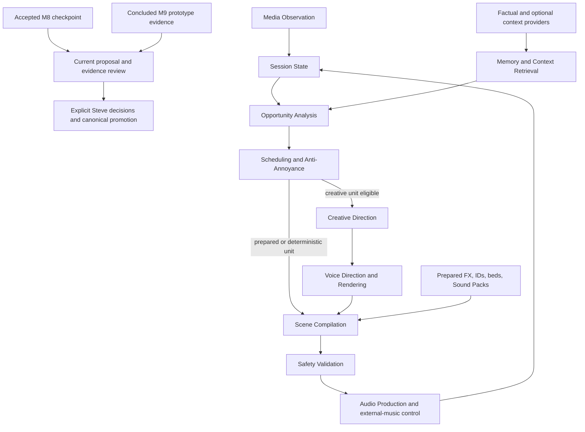

# Zoya Radio — Post-M8 Proposal Intake

## 1. Document Status

This document records proposals, refinements, disagreements, examples, research interpretations, and unresolved questions from the complete accessible **Zoya Radio — Design / Brainstorming** conversation. It is an intake record only.

- Every proposal in this document remains **unapproved** unless an explicit note says otherwise. No proposal card below is marked approved.
- Labels such as **Explicitly preferred** record preference inside the Brainstorming discussion only; they are not accepted Git decisions or approved project requirements.
- Milestone 8 was implemented and accepted for continued internal development under its bounded contract. Milestone 9 later concluded as prototype evidence without promoting its experimental commentary path into accepted runtime behavior.
- The post-M8 review stage this intake anticipated has now begun. Review still does not approve, schedule, or authorize any proposal automatically.
- Every promoted outcome still requires an explicit Steve decision and the appropriate canonical decision, roadmap, contract, or implementation task.
- A separate [future personal-station vision](FUTURE_PERSONAL_STATION_VISION.md) preserves the broader product experience and illustrative station concepts without making them current scope.
- Research can support, weaken, or complicate a proposal. It cannot approve a product decision.
- The local Git repository and its canonical documentation—especially the latest project-state and decision documents—remain authoritative for current implementation, milestone status, tests, and accepted architecture.
- This file contains no implementation instructions, milestone assignments, deadlines, or authorization for Codex to make changes.

### Boundary between present and future

The Brainstorming chat described the following as **historically demonstrated during the first-generation build**: Firefox/YouTube Music metadata observation; safe targeting and control of the Firefox media session; local Qwen comment generation with fixed fallback; a warm/dry host persona; automatic comment opportunities using a random 2–5-transition interval; bounded recent-track and recent-comment state; Silent Mode and history clearing; stale-comment abandonment; local Kokoro/Nicole speech prepared while music continued; Windows TTS fallback; cancellation and playback recovery. These statements summarize evidence discussed in the chat; they are not a substitute for checking the current repository.

The same discussion suggested usability, configuration, packaging, and UI work as a possible M8 direction. That is historical origin, not current status: canonical documents record what M8 actually accepted. Unpromoted material in this intake remains Brainstorming only and cannot retroactively enlarge M8 or authorize later work.

| Boundary | Meaning in this intake |
|---|---|
| Current implementation | Whatever the current local repository and canonical project documents demonstrate now; historical chat evidence is secondary. |
| Accepted M8 baseline | The internal-development baseline recorded by canonical project and milestone documents; this intake cannot alter it. |
| Concluded M9 exploration | Prototype evidence and unresolved limitations recorded by canonical M9 documents; no experimental M9 path became accepted runtime behavior merely by appearing here. |
| Post-M8 proposals | Candidates now available for explicit review, research, experimentation, acceptance, rejection, or parking. |
| Future product vision | Long-range, unapproved possibilities preserved separately where useful; they are not requirements or milestone scope. |

## 2. Purpose and Review Process

The Brainstorming conversation accumulated more design material than could safely be promoted while M8 was still ahead. This document preserves that material without letting enthusiasm become scope. M8 has since been accepted and the anticipated review stage has begun, but formal decisions still belong in canonical project documentation.

During review, each proposal may receive one of the following outcomes:

- **Accept for near-term planning**
- **Accept for later development**
- **Experiment first**
- **Research first**
- **Reject**
- **Park**

No outcome is assigned merely by being listed here. The first four historical steps were completed: M8 received a bounded contract, was implemented and manually accepted, a known-good checkpoint was created, and implementation paused for review. The current planning sequence is therefore:

1. review this intake, the research, canonical architecture, the accepted M8 baseline, the concluded M9 evidence, and real listening experience;
2. merge overlaps and identify dependencies or research gaps;
3. have Steve explicitly assign proposal outcomes;
4. record accepted direction in the appropriate canonical documents;
5. only then define bounded later milestones or implementation tasks.

The post-M8 review should compare each card with:

1. the checkpointed working application;
2. canonical repository documentation;
3. real listening experience after the accepted M8 checkpoint;
4. measured radio research;
5. resource, privacy, latency, and playback-safety constraints;
6. overlap with other cards, so several labels do not become several unnecessary subsystems.

## 3. Executive Inventory

| ID | Proposal group | Area | Maturity | Main dependency | Source status |
|---|---|---|---|---|---|
| ARCH-01 | Hybrid radio-production architecture | Architecture | Developed concept | Stable first-generation baseline | Explicitly preferred |
| ARCH-02 | Prepared-content binding, shelf life, and lifecycle | Architecture / runtime | Developed concept | Scheduler and typed content objects | Directly discussed |
| ARCH-03 | Typed inventory, composite scenes, and bounded randomness | Architecture / production | Research-backed | Content model and scheduler | Research-supported |
| RADIO-01 | Opportunity-based scheduler with independent clocks | Runtime / deterministic logic | Research-backed | Rich session state | Explicitly preferred |
| RADIO-02 | Music-first transition grammar and protected song bodies | Production / scheduling | Research-backed | Reliable transition observation | Research-supported |
| RADIO-03 | Deterministic continuity and announcement templates | Deterministic logic | Developed concept | Trusted metadata and localization | Explicitly preferred |
| RADIO-04 | Chained bits, track arcs, and multi-song formats | Runtime / production | Developed concept | Scene planning, timing, memory | Directly discussed |
| HOST-01 | Calm, dry host personality and rhetorical diversity | AI / host behavior | Developed concept | Prompt/context design | Explicitly preferred |
| HOST-02 | Session-aware habits, moods, obsessions, and grudges | AI / host behavior | Developed concept | Session and durable memory | Directly discussed |
| MEMORY-01 | Recent session state and deterministic pattern detection | Memory / deterministic logic | Partly demonstrated; developed extension | Media observation | Explicitly preferred |
| MEMORY-02 | Durable continuity, recurring bits, and station mythology | Memory | Developed concept | Promotion/retention rules | Directly discussed |
| KNOWLEDGE-01 | Controlled factual evidence packets | Research / AI | Developed concept | Trusted retrieval and provenance | Explicitly preferred |
| KNOWLEDGE-02 | Relevance-based caching, promotion, and entity matching | Research / memory | Developed concept | KNOWLEDGE-01 and MEMORY-01 | Directly discussed |
| AI-01 | Structured prompting and tiered, replaceable creative models | AI | Needs experiment | Director inputs and benchmark tasks | Directly discussed |
| VOICE-01 | Provider-neutral Voice Direction | Voice | Developed concept | Replaceable voice renderer | Explicitly preferred |
| VOICE-02 | Bounded multi-voice cast and acoustic role separation | Voice / production | Developed concept | Voice assets and mixer | Directly discussed |
| PROD-01 | Internal scene mixer, timeline, and FX library | Audio production | Developed concept | Reliable overlay and external-session control | Directly discussed |
| PROD-02 | Music-treatment vocabulary and Production Grammar | Audio production / safety | Developed concept | PROD-01 and transition safety | Explicitly preferred |
| PROD-03 | Sonic identity and offline Station Sound Packs | Production / branding | Developed concept | Offline preparation and human curation | Explicitly preferred |
| FORMAT-01 | Fictional commercials and recurring advertisers | Content format | Developed concept | Multi-voice production and transition scheduling | Directly discussed |
| FORMAT-02 | Prepared listener calls and recurring callers | Content format | Developed concept | Multi-voice scenes, FX, memory | Directly discussed |
| FORMAT-03 | Optional Five Queens context and micro-stories | AI / private context | Deliberately deferred | Curated private retrieval | Directly discussed |
| CONTEXT-01 | Deterministic time/date imaging | Deterministic logic / context | Developed concept | Local clock and localized templates | Directly discussed |
| CONTEXT-02 | Optional weather packets | Context / factual enrichment | Early developed concept | Optional location and provider | Directly discussed |
| CONTEXT-03 | Optional sourced news packets and separate host reactions | Context / research | Early idea; unresolved | Retrieval, provenance, shelf life | Directly discussed |
| LOCAL-01 | Language, locale, host identity, and cultural adaptation | Localization | Developed concept | Localized assets and evaluation | Explicitly preferred |
| UI-01 | Simple user controls with advanced complexity kept internal | UI / configuration | Competing alternatives | Accepted M8 interface baseline and CONFIG-01 | Directly discussed |
| SESSION-01 | Listening Session Lifecycle | Product contract / state | Gap-audit proposal; foundational | Deterministic media and application lifecycle evidence | Architecture-gap review |
| CAP-01 | Runtime Capability Registry and graceful degradation | Product contract / capabilities | Gap-audit proposal; foundational | Installed providers, assets, languages, and resource policy | Architecture-gap review |
| CONFIG-01 | Versioned Station / Listener Profile Model | Product contract / configuration | Gap-audit proposal; foundational | Validation, defaults, and capability model | Architecture-gap review |
| TRUST-01 | Untrusted Content and Instruction Boundary | Trust / safety | Gap-audit proposal; foundational | Typed inputs and deterministic execution authority | Architecture-gap review |
| OBS-01 | Editorial Decision Trace / Radio Explainability | Runtime operations / evaluation | Gap-audit proposal; foundational | Scheduler and structured decision reasons | Architecture-gap review |
| RESOURCE-01 | Preparation Budget / Runtime Quality Governor | Runtime operations / resources | Gap-audit proposal | Capability registry and preparation estimates | Architecture-gap review |
| DATA-01 | Persistent Data Lifecycle, Migration, and Recovery | Trust / persistence | Gap-audit proposal | Future durable storage | Architecture-gap review |
| ASSET-01 | Creative Asset Manifest and Provenance | Trust / assets | Gap-audit proposal | Typed inventory and Sound Packs | Architecture-gap review |
| POLICY-01 | Station Editorial Policy | Product contract / editorial safety | Gap-audit proposal | Configuration and all content formats | Architecture-gap review |
| FEEDBACK-01 | Listener Corrections and Preference Signals | Runtime evaluation / personalization | Gap-audit proposal; lower priority | Structured feedback and memory controls | Architecture-gap review |
| RESEARCH-01 | Empirical radio-production research programme | Research | Research-backed | Comparable recordings and methodology | Explicitly preferred |
| RESEARCH-02 | Model, voice, cadence, and resource experiments | Research / testing | Needs experiment | Repeatable benchmark tasks | Directly discussed |
| WORKFLOW-01 | Post-M8 checkpoint, consolidation, and role-separated workflow | Workflow | Historical boundary completed; review active | Canonical docs and explicit proposal decisions | Explicitly preferred |

## 4. Cross-Cutting Principles Discussed

| Principle | Standing in the discussion | Intake interpretation |
|---|---|---|
| Music remains central; silence is valid | Established project principle | Radio activity must earn attention. The station may remain silent across several songs or long spans. |
| User intent and safe playback win | Established project principle | Generated cost creates no right to airtime. Pause, skip, Silent Mode, ambiguity, missed timing, or shutdown can veto playback. |
| Deterministic facts, creative AI | Established project principle | Metadata, counters, timing, cooldowns, repetition, state, and safety should be computed; AI should interpret supplied facts creatively. |
| Local-first operation | Established project principle | Core operation should remain private and local where practical, with low gaming impact. Cloud/API services are optional enhancements, not requirements. |
| Factual claims require controlled evidence | Established project principle, refined in Brainstorming | Model memory is not authoritative music knowledge. Facts should carry provenance and identity confidence; uncertainty falls back to metadata, subjectivity, templates, or silence. |
| The radio is a system, not an LLM plus TTS | Developed Brainstorming direction, later added to project principles | Observation, state, eligibility, scheduling, creativity, voice, mixing, and safety are separate responsibilities. |
| Prepared content is disposable but not always invalid | Brainstorming refinement | A lost playback opportunity always cancels immediate execution; only broken dependencies invalidate the content itself. |
| Complex scenes should be prepared before their first audible beat | Developed Brainstorming direction | Calls, chains, commercials, and similar scenes should not expose model/TTS latency as awkward pauses. |
| What is said, how it is performed, and how it is mixed are separate | Developed Brainstorming direction | Creative text, performance intent, and audio engineering should remain independently replaceable and testable. |
| Localization is not translation | Established project principle | Language, locale, host identity, voice, and cultural reference are distinct. Locale should inform without stereotyping. |
| Memory should create continuity, not clutter | Established project principle | Useful jokes can persist and compress into terse callbacks; one-off material should not automatically become permanent. |
| Inventory variety and editorial cadence are different | Research-supported Brainstorming direction | Adding more callers or IDs should reduce repetition, not automatically increase how often that format airs. |
| Configuration, seeds, and earned history are different | Future product-vision refinement | Listener-defined facts configure the station; optional premises may inspire it; only observed or aired events become earned history. |
| Available capabilities constrain creative plans | Architecture-gap proposal | The system should know what this installation can render or retrieve before commissioning expensive or impossible material. |
| Untrusted text remains data | Architecture-gap safety proposal | Metadata, web evidence, listener text, memory, and model output cannot redefine system authority or directly execute playback/system actions. |
| Formats are capabilities, not obligations | Future product-vision refinement | Installed inventory does not create airtime; a station may disable calls, commercials, imaging, or long-form speech and remain music-first. |
| Research describes behavior; it does not prescribe product decisions | Established workflow principle | GTA and real-radio material can reveal abstract grammar, never authorize copying or automatically define defaults. |

## 5. Detailed Proposal Cards

### [ARCH-01] Hybrid radio-production architecture

**Status:** Unapproved post-M8 proposal  
**Area:** Architecture  
**Discussion maturity:** Developed concept  
**Origin:** The Listener Call discussion exposed the need for a “Director,” then repeatedly narrowed that idea away from one AI controlling the station.

**Proposal**

Treat future Zoya Radio as a small production team with conceptually separate responsibilities: Media Observation; Session State; Opportunity Analysis; Scheduling / Anti-Annoyance; Memory / Context Retrieval; Factual Enrichment; Creative Direction; Voice Direction and rendering; Scene Compilation; Audio Production / Mixing; Safety Validation; and state updates after airtime. The exact component boundaries remain open, but the separation of creative judgment from deterministic execution was repeatedly preferred.

**Problem or opportunity**

A single prompt cannot reliably count history, choose cadence, write material, place effects, control external audio, and enforce safety. Separating the jobs makes creative backends replaceable and gives user intent a deterministic veto.

**Illustrative behavior**

*Illustrative only:* Scheduling marks a Listener Call eligible; Creative Direction invents the caller and dialogue; Voice Direction specifies performance; TTS renders bounded voices; Scene Compilation resolves timing after real audio durations are known; the mixer performs the scene; Safety Validation cancels it if the target session becomes unsafe.

**Possible system responsibility**

- All listed conceptual components, with no assumption that each must become a separate process or service.
- Human curation for available voice, FX, imaging, and format capabilities.

**AI responsibility**

Replaceable AI backend for creative planning and writing only. State, scheduling, timing, mixing, and safety remain deterministic.

**Runtime or prepared**

Hybrid. Observation and arbitration are live; complex creative units may be planned and rendered before airtime.

**Dependencies**

- A stable first-generation application to preserve.
- Agreement on minimum component boundaries.
- Typed inputs/outputs between creative and deterministic responsibilities.

**Risks and tradeoffs**

- Excessive decomposition could create architecture for its own sake.
- Too little separation recreates the unsafe “giant AI Director.”
- A second-generation model could disrupt working behavior if attempted as an in-place rewrite without a checkpoint.

**Open questions**

- Which responsibilities need distinct components versus ordinary modules inside one application?
- Where exactly is the boundary between Opportunity Analysis and Scheduling?
- Does Creative Direction choose a format, or only fill one already selected by the scheduler?

**Related proposals**

ARCH-02, ARCH-03, RADIO-01, PROD-01, PROD-02, VOICE-01, WORKFLOW-01.

**Conversation conclusion**

Preferred in Brainstorming but still unapproved. The bounded M8 implementation and checkpoint are complete, so architecture consolidation is now eligible for explicit review. The mature radio might be hybrid and modular, but its smallest coherent form is still not settled.

### [ARCH-02] Prepared-content binding, shelf life, and lifecycle

**Status:** Unapproved post-M8 proposal  
**Area:** Architecture / runtime  
**Discussion maturity:** Developed concept  
**Origin:** Steve objected to deleting an expensive, song-independent commercial merely because the intended transition was skipped.

**Proposal**

Give prepared material explicit semantic dependencies (“binding”), freshness/shelf-life information, and a lifecycle that separates **cancellation** from **invalidation**. Losing a playback opportunity always means “do not play now.” It destroys the content only when the facts or circumstances on which it depends have stopped being valid.

Possible binding families discussed were track-bound, sequence-bound, artist-bound, session-bound, station-bound, time/event-bound, and evergreen inventory. Possible states included prepared, scheduled, displaced, deferred, rescheduled, aired, expired, and invalidated. These are conceptual labels, not an approved state machine.

**Problem or opportunity**

The current stale-comment rule correctly discards track-bound speech. Future commercials, IDs, calls, weather, news, or mythology scenes may remain valid after the specific transition disappears. Treating all content as equally stale either wastes useful production or risks playing nonsense.

**Illustrative behavior**

*Illustrative only:* A song-to-song segue is invalidated when either track changes. A generic fictional commercial is merely deferred. A weather line remains eligible until its observation expires. A news reaction may expire before the sourced news packet on which it was based.

**Possible system responsibility**

- Scheduling / Anti-Annoyance
- Memory / Context Retrieval
- Safety Validation
- Offline Content Preparation

**AI responsibility**

No AI is needed to evaluate explicit dependencies and expiration. AI may generate material and describe intended semantic dependencies, but deterministic code must enforce them.

**Runtime or prepared**

Hybrid. Content may be generated or produced in advance; validity and opportunity are re-evaluated live.

**Dependencies**

- Typed content objects.
- Source/fact versioning for enriched material.
- Scheduler capable of deferral without obligation.
- Clear record of whether a unit has aired.

**Risks and tradeoffs**

- A content warehouse could accumulate forgotten material.
- “We already paid to generate it” could bias the scheduler toward excessive speech.
- Reusing prose across subtly changed context can create plausible but wrong output.
- Shelf-life rules may become needlessly elaborate if every format invents its own system.

**Open questions**

- Which bindings are genuinely needed in the first post-M8 design?
- When should excellent generated material be promoted into reusable inventory?
- How are dependencies represented without requiring the LLM to understand storage policy?

**Related proposals**

ARCH-03, RADIO-01, KNOWLEDGE-01, KNOWLEDGE-02, FORMAT-01, FORMAT-02, CONTEXT-02, CONTEXT-03.

**Conversation conclusion**

Preferred conceptual refinement: user action vetoes airtime immediately, but content survives only when its dependencies and shelf life remain valid. Facts are more safely reusable than cached prose.

### [ARCH-03] Typed inventory, composite scenes, and bounded randomness

**Status:** Unapproved post-M8 proposal  
**Area:** Architecture / production  
**Discussion maturity:** Research-backed  
**Origin:** RadioSanAndreas repository research showed that a simple deterministic scheduler can create convincing modular behavior from typed assets and linked bundles.

**Proposal**

Represent reusable radio material in typed inventories and allow a complex unit to be scheduled atomically while retaining an internal ordered structure. Use bounded anti-repeat selection for finite assets instead of naïve independent random draws. Keep inventory size separate from editorial cadence.

The useful abstraction from RadioSanAndreas was not its GTA asset model or internet-radio stack. It was that a scheduler can select one logical object whose internals remain intact, and can suppress short-range repetition with little state.

**Problem or opportunity**

Station IDs, FX, voice variants, callers, and commercial elements need variety without clusters of immediate repetition. Complex calls or ads must not be split or reordered accidentally. Growing an asset library should improve variety, not make that format take over the station.

**Illustrative behavior**

*Illustrative only:* The scheduler sees one `LISTENER_CALL_SCENE`; internally it contains a bumper, host lines, caller lines, FX, hangup, and tag. An ID pool cycles with bounded randomness, while a separate imaging clock decides whether an ID belongs at the current transition.

**Possible system responsibility**

- Scheduling / Anti-Annoyance
- Scene Compilation
- Offline Content Preparation
- Human curation

**AI responsibility**

No AI is required for inventory selection or repeat avoidance. Offline AI may help create candidate assets; live AI may create new scene content inside the type constraints.

**Runtime or prepared**

Selected live from prepared assets, assembled live from prepared components, or hybrid for newly generated scenes.

**Dependencies**

- A small content schema.
- Recent-use tracking per asset family.
- Cadence rules independent of pool size.

**Risks and tradeoffs**

- Over-typing creative material could make formats rigid.
- A large inventory with weak curation can still sound incoherent.
- Research demonstrated a useful mechanism, not a Zoya-ready scheduler.

**Open questions**

- Which types require explicit schemas?
- Should a generated scene ever become durable inventory automatically, or only after human review?
- What minimum anti-repeat state produces natural variation across restarts?

**Related proposals**

ARCH-01, ARCH-02, RADIO-01, PROD-03, FORMAT-01, FORMAT-02.

**Conversation conclusion**

Research-supported direction. Import the abstract lessons—typed modules, atomic bundles, bounded randomness, and cadence/inventory separation—not RadioSanAndreas code, weights, mandatory interstitials, or infrastructure.

### [RADIO-01] Opportunity-based scheduler with independent clocks

**Status:** Unapproved post-M8 proposal  
**Area:** Runtime / deterministic logic  
**Discussion maturity:** Research-backed  
**Origin:** K-Rose, K-DST, and V-Rock showed that “how often the host speaks” cannot be represented by one 2–5-song counter.

**Proposal**

Treat every song transition as an **opportunity**, not an instruction to speak. The scheduler may choose silence, direct music, deterministic continuity, imaging, a short creative comment, longer host material, a caller, a commercial, a multi-module break, or part of a track-spanning format. Maintain separate internal clocks/budgets for boundary presence, active voice occupancy, creative AI cadence, imaging, long-form material, commercials, calls, transition length, and mid-song intrusion.

The original random 2–5 transition rule remains a useful prototype mechanism and might survive as one constraint on **substantial creative commentary**, but not as the complete mature abstraction.

**Problem or opportunity**

Frequency alone cannot distinguish a station that touches every boundary with tiny elements from one that speaks continuously. Independent clocks allow strong station presence without excessive Zoya speech.

**Illustrative behavior**

*Illustrative only:* one boundary is silent; the next gets a three-second ID; another gets deterministic continuity; after several songs a genuine session pattern earns a creative comment; a long call remains ineligible because recent voice occupancy is high.

**Possible system responsibility**

- Session State
- Opportunity Analysis
- Scheduling / Anti-Annoyance
- Safety Validation

**AI responsibility**

Deterministic logic selects eligibility and enforces budgets. AI may rank creative opportunities or choose among eligible creative formats, but it should not count time, tracks, or recent airtime.

**Runtime or prepared**

Live scheduling over a mix of live-generated and prepared content.

**Dependencies**

- Reliable transition events.
- Measured recent voice and format history.
- Defined content types and treatment rules.
- User-facing simplification of many internal dimensions.

**Risks and tradeoffs**

- Many internal clocks can become difficult to tune and explain.
- If all eligible formats compete without a coherent arbiter, the system may still feel random.
- Research samples are too small to justify fixed numeric defaults.

**Open questions**

- What is the smallest useful set of clocks?
- Should opportunity ranking be entirely deterministic, AI-assisted, or mixed?
- Which measurements best predict annoyance: speech time, break length, boundary activity, or attention demand?

**Related proposals**

RADIO-02, RADIO-03, RADIO-04, UI-01, RESEARCH-01, RESEARCH-02, ARCH-01.

**Conversation conclusion**

Preferred mature direction. Exact rates and default values remain deliberately unresolved and require broader research plus real-use testing.

### [RADIO-02] Music-first transition grammar and protected song bodies

**Status:** Unapproved post-M8 proposal  
**Area:** Production / scheduling  
**Discussion maturity:** Research-backed  
**Origin:** Three GTA station audits all left established central song bodies untouched despite very different personalities, voice occupancy, calls, commercials, and imaging.

**Proposal**

Treat the song as the privileged object. Long-form station material should overwhelmingly claim natural transition space rather than interrupt established song bodies. Direct song-to-song sweeps and long silent spans remain valid. Clean incoming launches should be a safe default when vocal-entry timing is unknown; talk-up over an incoming intro becomes a style/context choice only when timing information is reliable. Rare mid-song comments, chains, or rants remain possible but are a distinct, more intrusive class.

**Problem or opportunity**

Zoya must feel like radio without making the listener resent the host. Transition ownership creates program space; arbitrary mid-song pauses feel like an app hijacking music.

**Illustrative behavior**

*Illustrative only:* Song A ends, a prepared break airs, and Song B receives a clean launch. Another boundary is simply Song A to Song B. A rare chain uses two brief ducks with a long uninterrupted middle rather than constant interruptions.

**Possible system responsibility**

- Media Observation
- Scheduling / Anti-Annoyance
- Scene Compilation
- Audio Production / Mixing
- Safety Validation

**AI responsibility**

No AI is required to protect the song. AI may propose intent (“talk-up,” “short callback”), while deterministic production rules decide whether the requested treatment is safe.

**Runtime or prepared**

Hybrid.

**Dependencies**

- Reliable track-transition detection.
- Music-treatment rules.
- Optional future timing/structure knowledge for advanced talk-up.

**Risks and tradeoffs**

- Transition-only long-form material delays the next song and can still become intrusive.
- A rigid ban on all mid-song behavior would discard formats specifically developed in Brainstorming.
- GTA recordings were curated and know their song structure; arbitrary user music does not.

**Open questions**

- How much transition space can Zoya claim before it stops feeling music-first?
- Can reliable intro/vocal-entry information be obtained without fragile analysis?
- Which mid-song formats, if any, should be enabled by default?

**Related proposals**

RADIO-01, RADIO-04, PROD-02, FORMAT-01, FORMAT-02, RESEARCH-01.

**Conversation conclusion**

Strong provisional research-supported direction, not a fixed numeric rule. Protect central song bodies; let clean launches and silence remain normal; test any intrusive exceptions separately.

### [RADIO-03] Deterministic continuity and announcement templates

**Status:** Unapproved post-M8 proposal  
**Area:** Deterministic logic  
**Discussion maturity:** Developed concept  
**Origin:** Steve challenged the assumption that “That was X; now Y” requires AI.

**Proposal**

Build localized, human-reviewed template families for ordinary radio continuity using trusted metadata and deterministic state. Support previous-song identification, current-song introduction, bridges, artist-only or title-only tags, same-artist transitions, repeated-track variants, length classes, and silence. Track recently used template families to avoid robotic repetition.

**Problem or opportunity**

Routine continuity does not justify model latency, hallucination risk, or API cost. A non-AI layer also provides graceful behavior when the creative model or internet is unavailable.

**Illustrative behavior**

*Illustrative only:* “That was [title] by [artist]. Now [artist] with [title].” For the same artist, select “More [artist] now…” rather than repeating the name twice. If recent speech occupancy is high, choose an artist-only tag or silence.

**Possible system responsibility**

- Deterministic Template System
- Session State
- Scheduling / Anti-Annoyance
- TTS
- Human curation

**AI responsibility**

No live AI. Offline generation may help propose template candidates, but supported languages require review.

**Runtime or prepared**

Selected and assembled live from prepared templates.

**Dependencies**

- Reliable normalized artist/title metadata.
- Localized template libraries.
- Recent-template history.
- Pronunciation strategy remains an open voice concern.

**Risks and tradeoffs**

- A small library may become obviously mechanical.
- Bad localization can sound translated rather than broadcast-native.
- Metadata errors are repeated confidently unless validated.

**Open questions**

- Which template families are worth supporting first?
- How should unknown or malformed metadata degrade?
- Can user-editable templates help, or would that clutter configuration?

**Related proposals**

RADIO-01, LOCAL-01, CONTEXT-01, UI-01, AI-01.

**Conversation conclusion**

Explicitly preferred. Ordinary continuity should not pay an “intelligence tax.” The scheduler still decides whether continuity deserves airtime.

### [RADIO-04] Chained bits, track arcs, and multi-song formats

**Status:** Unapproved post-M8 proposal  
**Area:** Runtime / production  
**Discussion maturity:** Developed concept  
**Origin:** The Amos Moses examples evolved from one comment into spaced chain beats, an apparent discovery arc across a song, and later a format spanning several songs.

**Proposal**

Support rare planned structures whose meaning unfolds over time:

- **Chain:** several short remarks separated by music.
- **Track arc:** opening/follow-up/callback/closing beats across one song, often with a long untouched middle.
- **Cross-track chain:** a running observation follows an emerging playlist pattern.
- **Multi-song format:** the station frames a block, allows music to carry the middle, and reacts at the end.

The complete creative plan should generally exist before its first audible beat. Deterministic timing decides placement and abandons the remainder if the song or premise changes.

**Problem or opportunity**

One polished paragraph often sounds generated. Returning to a thought after music has breathed creates continuity of thought, apparent listening, escalation, and stronger payoffs while allowing most of the format's duration to remain music.

**Illustrative behavior**

*Illustrative only:* a first line establishes curiosity, a second adds one new fact, the song plays uninterrupted for minutes, and a late callback closes the premise. The cited scripts in Brainstorming are examples, not required wording.

**Possible system responsibility**

- Opportunity Analysis
- Creative Direction / LLM
- Session State
- Scene Compilation
- Scheduling / Anti-Annoyance
- Safety Validation

**AI responsibility**

Local or optional cloud/API LLM for the coherent plan; deterministic code for spacing, cancellation, and safe execution.

**Runtime or prepared**

Generated and rendered before first playback, then executed live against current music state.

**Dependencies**

- Reliable track age/transition observation.
- Scene representation.
- Memory of active premises and completed beats.
- Strict speech and intrusion budgets.

**Risks and tradeoffs**

- Repeated ducks can become infuriating quickly.
- Planned “discovery” may mismatch lyrics or track progress without reliable timing.
- A skip can strand a premise.
- Long-lived format state increases complexity and memory clutter.

**Open questions**

- What makes a song or sequence eligible for an arc?
- How many beats and how much uninterrupted music are tolerable?
- Should lyric-timed behavior ever be attempted, given sourcing and version matching risks?

**Related proposals**

RADIO-01, RADIO-02, ARCH-02, MEMORY-01, MEMORY-02, PROD-01, PROD-02.

**Conversation conclusion**

Developed but deliberately rare future format. The strongest position was to plan coherently, protect breathing room, and cancel rather than force unfinished beats into later music.

### [HOST-01] Calm, dry host personality and rhetorical diversity

**Status:** Unapproved post-M8 proposal  
**Area:** AI / host behavior  
**Discussion maturity:** Developed concept  
**Origin:** M4 tests showed that a warm, dry persona could make Steve laugh, while later M7B listening exposed repetitive “I picture / that sounds like” habits.

**Proposal**

Preserve the preferred host identity: warm, feminine, calm, intimate, dry, occasionally profane, affectionate but judgmental, and emphatically not an exaggerated morning-show announcer. The host may react, segue, offer fake wisdom, make a personal aside, advance station lore, or simply announce music. Track recent rhetorical openings, structures, direct address, and comedic moves so the next prompt can cool down overused habits.

**Problem or opportunity**

A consistent point of view creates identity, but a small model with sparse metadata falls into high-probability phrases and title reactions. “Be varied” is insufficient without deterministic repetition evidence and a reason for the intervention.

**Illustrative behavior**

*Illustrative only:* a soft Nicole-style delivery makes terse disapproval or absurd seriousness funnier than a deliberately comedic voice. A recent-style summary tells the model not to reuse “I picture,” “that sounds like,” or repeated “Steve.” openings.

**Possible system responsibility**

- Creative Direction / LLM
- Session State
- Memory / Context Retrieval
- Voice Direction

**AI responsibility**

Local LLM by default; optional stronger backend if testing shows meaningful gains. Deterministic tracking supplies overuse constraints.

**Runtime or prepared**

Mostly generated live; persona examples and prohibited/overused structures are prepared configuration.

**Dependencies**

- Structured prompt context.
- Recent-comment and rhetorical-style history.
- A defined host identity separate from locale and voice.

**Risks and tradeoffs**

- Too much self-conscious variation can make the host inconsistent.
- Profanity and direct teasing need user control and cultural adaptation.
- A stronger model may improve prose without solving poor context selection.

**Open questions**

- Which aspects of Zoya's personality are fixed versus user-configurable?
- How much recent text/style history is enough to prevent repetition without bloating prompts?
- Should the host sometimes fail to finish a thought as a deliberate imperfection, and how rarely?

**Related proposals**

AI-01, HOST-02, MEMORY-01, MEMORY-02, VOICE-01, LOCAL-01, UI-01.

**Conversation conclusion**

Preferred direction. Improve prompting, situation context, and rhetorical tracking before concluding that the local model is inherently inadequate.

### [HOST-02] Session-aware habits, moods, obsessions, and grudges

**Status:** Unapproved post-M8 proposal  
**Area:** AI / host behavior  
**Discussion maturity:** Developed concept  
**Origin:** Repeated-song and genre-whiplash examples evolved into bird grudges, yacht obsession, temporary session themes, moods, and compressed callbacks.

**Proposal**

Let the host behave like a companion who has been listening to the session, not a stateless reviewer. Supply deterministic evidence about repetitions, skips, abrupt transitions, artist streaks, elapsed time, prior comments, and active bits. Allow a bounded set of longer-lived habits or attitudes—obsessions, grudges, recurring phrases, or slight moods—to influence generation without forcing them into every comment.

Some themes may be configured traits; others may emerge temporarily from the session and expire. Host mood was discussed as a subtle weighting, not dramatic role-play.

**Problem or opportunity**

The product's distinctive advantage over authored GTA radio is that the listener supplies the subject matter. Continuity turns statistics into a relationship and reduces pressure to invent song facts.

**Illustrative behavior**

*Illustrative only:* after several bird references, the system records a strong temporary “bird problem.” Early comments explain it; months later an established callback may be only “No,” a count, or a brief reference. Yacht material may recur occasionally and even acknowledge its own overuse.

**Possible system responsibility**

- Session State
- Opportunity Analysis
- Memory / Context Retrieval
- Creative Direction / LLM
- Scheduling / Anti-Annoyance

**AI responsibility**

AI writes the occurrence; deterministic systems detect the evidence, strength, cooldown, and eligibility.

**Runtime or prepared**

Generated live from current state and selected durable memory.

**Dependencies**

- MEMORY-01 and MEMORY-02.
- Clear separation between factual knowledge and fictional attitude.
- Cooldowns and retirement rules.

**Risks and tradeoffs**

- Obsessions can become repetitive or annoying.
- Persistent grudges can feel hostile without tone controls.
- Weak promotion/expiry rules create mythology clutter.
- Inferring “mood” from time or music can become stereotyped or arbitrary.

**Open questions**

- Which host traits are default, selected by the user, or learned from use?
- When does an emerging session theme become a durable bit?
- How can the user retire a bit without micromanaging the station?

**Related proposals**

HOST-01, MEMORY-01, MEMORY-02, AI-01, LOCAL-01, UI-01.

**Conversation conclusion**

Strongly favored as a future source of personality, but not as unrestricted memory. The host's continuity must remain selective, terse over time, and subordinate to music.

### [MEMORY-01] Recent session state and deterministic pattern detection

**Status:** Unapproved post-M8 proposal  
**Area:** Memory / deterministic logic  
**Discussion maturity:** Developed concept with demonstrated first-generation primitives  
**Origin:** Steve proposed a rolling last-ten-track memory; M5 later demonstrated bounded track history, repetition detection, recent comments, and stale-content cancellation.

**Proposal**

Maintain compact, deterministic session facts rather than asking the LLM to infer them from prose: recent tracks and transitions, timestamps, repeats, distinct artists, skips, accepted comments, rhetorical forms, elapsed session time, host airtime, format history, active premises, Silent Mode, and cooldowns. The exact window need not remain ten tracks; it should match each decision.

**Problem or opportunity**

Session-shaped commentary is more personal and safer than title-only improvisation. Explicit state makes counting reliable and prompts smaller.

**Illustrative behavior**

*Illustrative only:* the application records that one artist appeared three times, four tracks formed a bird theme, or several skips happened quickly. Creative Direction receives the relevant facts, not a raw transcript and an instruction to count.

**Possible system responsibility**

- Media Observation
- Session State
- Opportunity Analysis
- Scheduling / Anti-Annoyance

**AI responsibility**

No AI for observation or counting. AI interprets selected facts creatively.

**Runtime or prepared**

Generated live from observed playback and station events.

**Dependencies**

- Stable media identity and timestamps.
- Bounded retention and clear reset behavior.
- Separation from durable memory.

**Risks and tradeoffs**

- Metadata aliases and live/remastered labels can split one entity.
- Excessive state may increase prompt noise or privacy concerns.
- Skip interpretation can be ambiguous.

**Open questions**

- Which facts are session-only, and which may be promoted?
- What should history clearing remove?
- How much state should survive application restarts?

**Related proposals**

HOST-02, MEMORY-02, KNOWLEDGE-02, RADIO-01, AI-01, UI-01.

**Conversation conclusion**

Explicitly preferred and partly proven. Future work would enrich the state model, not replace deterministic observation with model inference.

### [MEMORY-02] Durable continuity, recurring bits, and station mythology

**Status:** Unapproved post-M8 proposal  
**Area:** Memory  
**Discussion maturity:** Developed concept  
**Origin:** Bird, alligator, yacht, Susan, advertiser, and caller examples demonstrated how a premise could recur months later in compressed form.

**Proposal**

Keep a selective durable layer for relationships and fictional continuity: recurring bits, host attitudes, useful callers, fictional advertisers, station events, prior resolutions, and listener-specific inside jokes. Preserve concise structured premises and recent use, not every transcript. Mature bits should often compress through stages: notice, tease, escalate, establish, then use terse callbacks.

**Problem or opportunity**

Durable continuity makes the station feel personal and gives later remarks meaning without forcing fresh exposition. It also prevents the Director from accidentally recreating or contradicting old lore.

**Illustrative behavior**

*Illustrative only:* a caller becomes recognizable by a ringtone; a fictional advertiser later becomes a station nemesis; an old bird problem needs only a count or single word. These are examples of memory behavior, not required canon.

**Possible system responsibility**

- Memory / Context Retrieval
- Session State
- Scheduling / Anti-Annoyance
- Human curation or user controls for pin/retire

**AI responsibility**

AI may propose a new memory or rewrite it compactly. Deterministic promotion, cooldown, expiry, and retrieval should control what persists and returns.

**Runtime or prepared**

Hybrid: created from live sessions, stored locally, retrieved selectively.

**Dependencies**

- Clear memory schema and provenance of observed versus fictional material.
- Promotion/retirement rules.
- UI for clearing or inspecting durable material, if exposed.

**Risks and tradeoffs**

- Memory clutter and continuity contradictions.
- Repetition can make a funny bit exhausting.
- Storing raw personal history raises privacy and transparency concerns.

**Open questions**

- What demonstrates that a one-off deserves promotion?
- Should users be able to pin, edit, or retire station lore?
- How are conflicting or embarrassing memories corrected?

**Related proposals**

MEMORY-01, HOST-02, FORMAT-01, FORMAT-02, FORMAT-03, UI-01.

**Conversation conclusion**

Preferred future capability with strong restraint. Memory should produce continuity, not an indiscriminate archive.

### [KNOWLEDGE-01] Controlled factual evidence packets

**Status:** Unapproved post-M8 proposal  
**Area:** Research / AI  
**Discussion maturity:** Developed concept  
**Origin:** M3/M4 tests showed funny but unsupported claims about unfamiliar, foreign-language, and obscure songs; Work then proposed an evidence layer.

**Proposal**

Do not give the Creative Director unrestricted web access or treat model memory as evidence. A controlled enrichment provider should return compact claims with subject, source, retrieval time, identity/matching confidence, freshness, and internal evidence IDs. A factual generated claim should map to supplied evidence internally; citations remain unspoken. Failed or ambiguous lookup falls back to metadata, subjectivity, wordplay, templates, or silence.

Lyrics remain a separate sourcing, licensing, version-matching, and timing problem. Full articles or lyric sheets should not become routine stored context.

**Problem or opportunity**

One verified hook can improve a joke dramatically, but factual enrichment can turn Zoya into an encyclopedia or permanent hallucination source if left uncontrolled.

**Illustrative behavior**

*Illustrative only:* a short comment receives one relevant claim; a rare researched rant receives several. The Director may use only those claims as real-world facts and records which were aired.

**Possible system responsibility**

- Factual Enrichment
- Memory / Context Retrieval
- Creative Direction / LLM
- Safety/validation for factual claims

**AI responsibility**

AI may summarize retrieved sources into candidate claims and write creatively from approved packets. Retrieval, source capture, matching, and claim allowance require deterministic boundaries and reviewable records.

**Runtime or prepared**

Prefer background retrieval and caching; consume prepared packets at runtime.

**Dependencies**

- Trusted sources and retrieval policy.
- Entity matching.
- Refresh/expiry rules.
- Internal usage tracking.

**Risks and tradeoffs**

- Bad sources, incorrect matching, stale facts, API/network failure, copyright, and cost.
- The Director may distort valid evidence.
- Too much context can displace personality and music.

**Open questions**

- Which sources are acceptable for which claim types?
- How is a generated factual claim checked against evidence IDs?
- Is lyric enrichment viable without fragile scraping or unclear licensing?

**Related proposals**

KNOWLEDGE-02, AI-01, ARCH-02, CONTEXT-02, CONTEXT-03, RESEARCH-02.

**Conversation conclusion**

Explicitly preferred conceptual firewall. Search should make Zoya better informed, not necessarily more informative.

### [KNOWLEDGE-02] Relevance-based caching, promotion, and entity matching

**Status:** Unapproved post-M8 proposal  
**Area:** Research / memory  
**Discussion maturity:** Developed concept  
**Origin:** Steve proposed keeping song and artist notes after repeated appearances; the discussion refined this into source-backed claim records and “cache first, promote later.”

**Proposal**

Research and durable storage should follow demonstrated listening relevance rather than every one-off track. Keep artist facts, composition/song facts, exact recording facts, observed local properties, listener/session history, and fictional station mythology separate. Artist knowledge is usually more reusable than song knowledge. Use an ephemeral research cache first; promote selected claims only when an artist/song remains relevant through repeated appearances, distinct tracks, multiple sessions, explicit interest, prior useful research, or an established bit.

Map messy observed metadata to canonical entities with confidence before durable promotion. Track when a fact was last used so Zoya does not repeat it constantly.

**Problem or opportunity**

This avoids repeated searches while preventing a permanent dossier for every autoplay accident. Entity mistakes become especially damaging once facts persist.

**Illustrative behavior**

*Illustrative only:* several appearances make an artist research-eligible. Background enrichment populates artist claims; a specific track record remains uncertain about live/remaster identity. Later a new track by that artist can reuse artist context without asserting recording-specific facts.

**Possible system responsibility**

- Session State
- Factual Enrichment
- Memory / Context Retrieval
- Human/user pinning as a possible advanced control

**AI responsibility**

No AI should decide truth. AI may assist extraction or matching, but deterministic thresholds, confidence, provenance, and review govern promotion.

**Runtime or prepared**

Background/offline retrieval with local cached use at runtime.

**Dependencies**

- KNOWLEDGE-01.
- Canonical identity and alias handling.
- Local storage and privacy controls.

**Risks and tradeoffs**

- Thresholds may overfit Steve's listening habits.
- Promotion can preserve bad matches or stale claims.
- Storage, refresh, and debugging complexity may exceed the value of occasional trivia.

**Open questions**

- What relevance signals are useful without becoming a large scoring system?
- How long should temporary research remain cached?
- Should users be able to pin artists or songs for research?

**Related proposals**

KNOWLEDGE-01, MEMORY-01, MEMORY-02, AI-01, UI-01.

**Conversation conclusion**

Developed preferred direction: source-backed facts, artist-first reuse, cache before promotion, and strict separation from listener history and mythology. Exact thresholds remain unresolved.

### [AI-01] Structured prompting and tiered, replaceable creative models

**Status:** Unapproved post-M8 proposal  
**Area:** AI  
**Discussion maturity:** Needs experiment  
**Origin:** Qwen generated amusing short lines but also repetitive title reactions; Steve raised future API use for quality, and the discussion refused to blame model size alone.

**Proposal**

Give the creative model a structured **situation**, not only title and artist: why the opportunity was selected, relevant session facts, permitted format, time/word budget, grounding mode, recent rhetorical habits, eligible memory, supplied evidence, and unavailable claims. Support replaceable model backends and possibly tier generation by task: no LLM for deterministic continuity; inexpensive local model for quick comments; stronger local or optional API model for chains, calls, or long-form scenes.

Text generation and voice generation remain independently configurable. Cloud/API use is a valid optional private enhancement, never a core dependency.

**Problem or opportunity**

A larger model given poor inputs may produce better-written versions of the same title-based problem. A tiered design may reserve expensive inference for tasks where quality matters.

**Illustrative behavior**

*Illustrative only:* `PLAIN RADIO` receives metadata and a template; `SESSION OBSERVATION` receives deterministic pattern facts; `TRUSTED ENRICHMENT` receives evidence IDs; `STATION CALLBACK` receives a compact established premise and favors brevity.

**Possible system responsibility**

- Opportunity Analysis
- Memory / Context Retrieval
- Creative Direction / LLM
- UI / Configuration

**AI responsibility**

Local LLM, optional cloud/API LLM, and replaceable backend. Model choice follows measured task quality rather than size alone.

**Runtime or prepared**

Mostly generated live or pre-generated shortly before airtime; prompt examples and model policies are prepared.

**Dependencies**

- Repeatable benchmark situations.
- Structured context providers.
- Cost/privacy controls for optional API use.

**Risks and tradeoffs**

- API expense and external data exposure.
- Larger local models may compete with games for GPU/RAM.
- Tier routing can add complexity and inconsistent voice/personality.

**Open questions**

- Which tasks actually need more than Qwen 4B after context improvements?
- Should a model select its own format, or receive one?
- How are cost and privacy displayed for hybrid modes?

**Related proposals**

HOST-01, HOST-02, RADIO-03, KNOWLEDGE-01, VOICE-01, UI-01, RESEARCH-02.

**Conversation conclusion**

Experiment first. Improve inputs, prompts, repetition constraints, and architecture before replacing the current model; then compare identical tasks across local and API options.

### [VOICE-01] Provider-neutral Voice Direction

**Status:** Unapproved post-M8 proposal 
**Area:** Voice 
**Discussion maturity:** Developed concept 
**Origin:** Steve noted that hosts, commercials, callers, and IDs depend on tone,
cadence, pace, whispering, shouting, and other performance qualities that basic TTS
may not reproduce. Later sonic-identity discussion clarified that fixed imaging and
runtime commentary have different constraints.

**Proposal**

Represent semantic performance intent separately from the canonical script, voice
identity, and production treatment. Illustrative intent may describe emotion, energy,
pace, delivery style, emphasis, attitude, or optional paralinguistic behavior. Those
examples are not an approved schema. A recognizable host voice should be able to
remain the same identity while performing warmly, deadpan, irritated, excited,
intimately, conspiratorially, or in announcer style.

A provider-neutral Voice Renderer translates supported intent into a selected local
or optional cloud backend and reports or gracefully degrades unsupported capabilities.
Backend-specific punctuation or script adjustment may remain a renderer technique,
but deliberately mangled text should not be the authoritative representation of
emotion.

**Prepared imaging versus runtime speech**

Reusable station imaging can render offline, audition several takes, use a heavier
expressive backend, receive production treatment, and store the accepted result as a
local asset. Dynamic host commentary usually renders near airtime and must respect
latency, resources, local-first policy, and Safe Playback. The two paths need not use
the same renderer or provider.

**Responsibility boundaries**

- Creative text determines what is said.
- Voice identity determines who is recognizably speaking.
- Voice Direction describes how the line should be performed.
- The renderer realizes the supported performance.
- Audio Production handles level matching, compression, EQ/filtering, saturation,
  spatial treatment, FX, music placement, and ducking.

Turning down ordinary speech is not whispering; amplifying it is not shouting.

**Dependencies**

- Provider-neutral direction vocabulary and renderer capability reporting.
- Stable voice identity across useful performance ranges.
- CAP-01 capability awareness, PROD-01 production, and comparative evaluation.

**Risks and open questions**

- Expressive instructions may be ignored or interpreted inconsistently.
- Backend changes may alter identity, cost, privacy, latency, language quality, or
  licensing suitability.
- Which minimum vocabulary transfers usefully across providers?
- Which unsupported directions degrade safely, and which make a prepared take
  unacceptable?

**Related proposals:** VOICE-02, PROD-01, PROD-03, CAP-01, AI-01, LOCAL-01,
ASSET-01, RESEARCH-02. 
**Conversation conclusion:** Explicitly preferred provider-neutral principle. Nicole
remains a successful baseline rather than a permanent ceiling; future model choices
require empirical comparison and no named provider is approved here.

### [VOICE-02] Bounded multi-voice cast and acoustic role separation

**Status:** Unapproved post-M8 proposal  
**Area:** Voice / production  
**Discussion maturity:** Developed concept  
**Origin:** Fictional commercials and listener calls sounded implausible if Nicole voiced every role; radio research also showed different acoustic spaces for host, callers, announcers, and ads.

**Proposal**

Maintain a bounded installed cast for roles such as Zoya, station announcers, callers, commercial narrators, actors, and disclaimer voices. Creative Direction requests a role/profile that actually exists rather than inventing unavailable voices. Use production processing to distinguish locations and functions: clean studio host, telephone-band caller, compressed announcer, stereo commercial, and so on.

**Problem or opportunity**

Role separation creates the illusion of a station world and prevents every format from sounding like “Zoya doing another joke.” A bounded cast keeps generation executable.

**Illustrative behavior**

*Illustrative only:* Nicole remains the host; a caller uses a different voice plus telephone filtering; an ID uses a recurring announcer; a rapid disclaimer uses another bounded profile.

**Possible system responsibility**

- Voice Direction
- TTS / Voice Renderer
- Audio Production / Mixing
- Offline Content Preparation
- Human curation

**AI responsibility**

AI selects from available semantic roles; renderers and mixers handle actual voices and treatment.

**Runtime or prepared**

Hybrid; frequently reused branded roles may be pre-produced, while caller dialogue may render per scene.

**Dependencies**

- Voice inventory and licensing/consent clarity.
- PROD-01.
- Consistent acoustic profiles.

**Risks and tradeoffs**

- Voice inconsistency, offensive accent imitation, storage, and provider limitations.
- Too many voices increase setup and curation burden.
- Voice cloning was not established as a requirement and should not be inferred.

**Open questions**

- How many roles are enough for variety?
- Should caller accents ever be used, and under what quality/cultural safeguards?
- Which voices ship locally versus remain optional?

**Related proposals**

VOICE-01, PROD-01, PROD-03, FORMAT-01, FORMAT-02, LOCAL-01.

**Conversation conclusion**

Developed preferred direction for special formats. Exact cast, providers, and accent policy remain unresolved.

### [PROD-01] Internal scene mixer, timeline, and FX library

**Status:** Unapproved post-M8 proposal  
**Area:** Audio production  
**Discussion maturity:** Developed concept  
**Origin:** Steve asked how Zoya, a quieter phone ring, a caller, and externally playing Firefox music could overlap.

**Proposal**

Let Zoya Radio produce one controlled internal station stream containing host voices, callers, jingles, beds, and FX while Windows mixes that stream with the separately controlled Firefox session. Use a scene timeline so overlapping events are placed after real TTS durations are known. Maintain a small curated FX library with multiple variants for functional, atmospheric, and comedy effects.

The scene planner describes relationships (“ring under the latter half of this line”), while Scene Compilation resolves exact timing. Telephone, paper, chair, and similar FX generally need no AI.

**Problem or opportunity**

Well-timed audio creates an imaginary studio and makes scenes feel produced rather than like sequential TTS clips. An internal mixer avoids independent playback objects fighting over timing.

**Illustrative behavior**

*Illustrative only:* Firefox is ducked; host speech stays foreground; a ring sits quietly behind it; pickup stops the ring; a filtered caller enters; scribbling overlaps a later line; hangup and restore complete the scene.

**Possible system responsibility**

- Scene Compilation
- Audio Production / Mixing
- Safety Validation
- Offline Content Preparation
- Human curation

**AI responsibility**

AI may request semantic FX and relationships from an allowed list. Deterministic systems choose approved files, levels, timing, filters, and fades.

**Runtime or prepared**

Assembled live from prepared components, often with voices rendered before the scene begins.

**Dependencies**

- Reliable Firefox-only attenuation.
- Audio timeline and mixer.
- FX assets and variant-selection rules.

**Risks and tradeoffs**

- Mixing bugs can create clipping, startling volume, or failed restoration.
- Overused atmospheric FX turn the station into a soundboard.
- Added audio processing increases testing and resource complexity.

**Open questions**

- Should scenes be mixed into a single file before airtime or streamed from a live timeline?
- What loudness and headroom standards are required?
- Which FX are useful enough to justify curation?

**Related proposals**

ARCH-01, PROD-02, VOICE-02, PROD-03, FORMAT-01, FORMAT-02.

**Conversation conclusion**

Developed long-range production concept. The difficult problem is not playing a WAV; it is using effects sparingly and safely enough to support the illusion.

### [PROD-02] Music-treatment vocabulary and Production Grammar

**Status:** Unapproved post-M8 proposal  
**Area:** Audio production / safety  
**Discussion maturity:** Developed concept  
**Origin:** Steve distinguished a listener call over ducked music from a commercial that should replace program space at a transition.

**Proposal**

Define semantic treatments for how formats may interact with external music: **LEAVE**, **DUCK**, **RIDE**, **FADE_ZERO** (short, still-playing silence), **PAUSE_TRANSITION**, and **PAUSE_AND_REPLACE**. Format defaults constitute a Production Grammar; Creative Direction requests intent, while deterministic audio and safety systems control exact curves, levels, timing, and whether the action is allowed.

Ordinary comments, rants, and calls generally use ducking or riding. A very short dramatic beat may fade a still-playing track near zero. Commercials and self-contained station pieces generally own a transition and pause/replace external music rather than interrupting the middle of a song.

**Problem or opportunity**

Binary pause/duck is too crude for radio-like production, while unconstrained AI mixer control is unsafe.

**Illustrative behavior**

*Illustrative only:* music gently falls under a call; a punchline briefly removes the bed; a commercial waits for a boundary, pauses Firefox, plays its own bed and voices, then resumes the next track safely.

**Possible system responsibility**

- Scheduling / Anti-Annoyance
- Scene Compilation
- Audio Production / Mixing
- Safety Validation

**AI responsibility**

No AI for exact audio control. AI may choose among permitted semantic treatments for a selected format.

**Runtime or prepared**

Live execution of prepared semantic plans.

**Dependencies**

- PROD-01.
- Reliable original-volume tracking and restoration.
- Transition eligibility and format rules.

**Risks and tradeoffs**

- Fade-to-zero while playback continues makes the listener miss music.
- Pause/replace can become as annoying as real commercials.
- User volume changes during ducking complicate restoration.

**Open questions**

- Which treatments are allowed by default for each format?
- How are manual volume changes reconciled during a scene?
- Is mid-song `RIDE` worth the complexity outside rare formats?

**Related proposals**

RADIO-02, PROD-01, FORMAT-01, FORMAT-02, ARCH-01, RESEARCH-02.

**Conversation conclusion**

Explicitly preferred conceptual grammar. Commercials are transition-owned replacement material; ordinary host content normally overlays ducked music; exact production values require testing.

### [PROD-03] Sonic identity and offline Station Sound Packs

**Status:** Unapproved post-M8 proposal 
**Area:** Production / branding 
**Discussion maturity:** Developed concept 
**Origin:** Steve proposed a recognizable combination of musical cues and announcer
performance; later discussion clarified a progressive setup workflow instead of
generating unrelated jingles repeatedly or exposing audio-engineering controls.

**Proposal**

Create station sonic identity during initial setup, customization, an explicit later
imaging refresh, or another offline preparation stage—not normally while music is
playing. A plausible progressive workflow is:

1. prepare a very small number of meaningful master identities or IDs;
2. let the listener audition subjective alternatives such as A or B;
3. select one direction as the station's sonic DNA;
4. derive a coherent family of related assets;
5. curate and store accepted results locally;
6. let runtime treat them as ordinary reusable typed assets.

The listener chooses what sounds like the station. They should not normally configure
compressor ratios, EQ curves, reverb, pitch contours, or loudness targets.

A future Sound Pack might contain a master motif, full and micro IDs, stings,
bumpers, sweeps, beds, branded FX, announcer profiles, and intensity or late-night
variants. This list is illustrative, not a frozen v1 schema. Recognition should come
from controlled repetition and related variation rather than endless novelty.

**Default, custom, and shared material**

A curated default Zoya Radio pack may be reusable across users. Custom generation is
more relevant when station name, identity, locale, host, or sound changes. Generic,
properly licensed production utilities—rings, paper, doors, room tone, crowds,
vinyl/radio noise, impacts—may be shared; motifs, station-name performances,
distinctive stings, and branded cues are more likely station-specific. Localization
should inform identity without forcing stereotypes.

**Preparation and runtime boundary**

Offline creation may use local tools, optional services, human production, or
user-supplied assets. Candidates may take longer, produce multiple takes, and use
different voice/audio systems from runtime commentary. Once accepted, scheduling
mainly cares that an asset is valid, available, typed, appropriate, and safe—not how
it was made. Provenance, licence/consent information where relevant, and master-to-
variant relationships belong to preparation/library management through ASSET-01.

An explicit future “Refresh Station Imaging” workflow may add variants while
preserving recognizable continuity rather than replacing the identity blindly.

**Dependencies**

- Candidate audition/selection and asset-library workflow.
- Rights, consent, provenance, local storage, loudness QA, and fatigue evaluation.
- PROD-01, VOICE-01/02, ASSET-01, CAP-01, and imaging cadence.

**Risks and open questions**

- Generative workloads may be heavy and licence/distribution suitability unclear.
- Weakly related variants dilute identity; too much imaging becomes clutter.
- Is one curated default pack sufficient initially?
- How much customization is useful without turning station setup into a production
  console?
- How should motif continuity survive later refreshes?

**Related proposals:** ARCH-03, RADIO-01, VOICE-01/02, PROD-01, LOCAL-01, UI-01,
CONFIG-01, CAP-01, ASSET-01. 
**Conversation conclusion:** Preferred future model: progressive, curated,
recognizable, reusable, provider-neutral, and offline. It is product vision, not an
approved provider, asset schema, or implementation task.

### [FORMAT-01] Fictional commercials and recurring advertisers

**Status:** Unapproved post-M8 proposal  
**Area:** Production / content format  
**Discussion maturity:** Developed concept  
**Origin:** A joke about an Amos Moses perfume developed into fictional brands, separate commercial voices, variable lengths, host reactions, and persistent advertiser lore.

**Proposal**

Allow rare, unmistakably fictional/satirical commercials with their own cast, beds, FX, jingles, disclaimers, and lengths. Formats may range from a short bumper to a produced multi-character scene. Brands can recur and develop station relationships, but should not imply real sponsorship or make claims about real companies.

Commercials normally behave as self-contained station material inserted at transitions through `PAUSE_AND_REPLACE`. A lost transition may defer a track-independent ad rather than destroy it. Host reaction is a separate optional object, not a mandatory tag.

**Problem or opportunity**

Commercials add station-world texture and sonic variety, but risk recreating the most disliked part of broadcast radio.

**Illustrative behavior**

*Illustrative only:* the conversation's fictional brands and Sue/Susan pun demonstrate tone and continuity; they are examples, not a required catalogue or scripts.

**Possible system responsibility**

- Scheduling / Anti-Annoyance
- Creative Direction / LLM
- Voice Direction / TTS
- Scene Compilation
- Audio Production / Mixing
- Memory / Context Retrieval

**AI responsibility**

Local or optional cloud/API AI for copy and scenes; deterministic scheduling and fictional-brand safeguards; offline production for recurring assets.

**Runtime or prepared**

Hybrid, with complete production prepared before airtime and strong potential for reusable inventory.

**Dependencies**

- FORMAT-appropriate scheduler clock.
- PROD-01/02, VOICE-02, ARCH-02, MEMORY-02.

**Risks and tradeoffs**

- Excessive length/frequency, real-brand confusion, imitation/copyright risk, production cost, and lore clutter.
- A saved ad may be forced merely because it exists unless scheduler restraint is explicit.

**Open questions**

- Should fictional ads be enabled by default?
- What length/frequency distribution is tolerable?
- When does a generated ad become curated inventory?

**Related proposals**

RADIO-01, RADIO-02, ARCH-02, VOICE-02, PROD-01, PROD-02, MEMORY-02, UI-01.

**Conversation conclusion**

Developed long-range format, intentionally rare. Transition ownership, separate voices, fictional clarity, and optional reaction were the strongest positions.

### [FORMAT-02] Prepared listener calls and recurring callers

**Status:** Unapproved post-M8 proposal  
**Area:** Production / content format  
**Discussion maturity:** Developed concept  
**Origin:** Steve proposed a call from “Slow Dog”; the conversation expanded it into a fully prepared multi-voice scene with FX and possible recurring callers.

**Proposal**

Allow occasional fictional listener-call scenes. Eligibility may depend on session length, recent long-form activity, available program space, and chance rather than a fixed hourly trigger. The whole dialogue, voices, effects, and production plan should be ready before the phone audibly rings. Callers may be one-offs or selectively promoted recurring characters; they should sometimes surprise or challenge Zoya rather than merely feed her punchlines.

Calls normally play over deeply ducked music so a long scene does not extend the song through repeated pauses. Calls may be track-bound, session-bound, or station-bound, which affects deferral and invalidation.

**Problem or opportunity**

Calls make the station feel as if it has a world outside the room and give the host another personality to interact with.

**Illustrative behavior**

*Illustrative only:* phone ring, host greeting, telephone-filtered caller, natural pauses, optional request/refusal, hangup, and a short host tag. Specific caller examples are not required canon.

**Possible system responsibility**

- Scheduling / Anti-Annoyance
- Creative Direction / LLM
- Voice Direction / TTS
- Scene Compilation
- Audio Production / Mixing
- Memory / Context Retrieval

**AI responsibility**

AI plans and writes the full call; deterministic systems enforce available voices, duration, FX, music treatment, safety, and cadence.

**Runtime or prepared**

Generated and rendered ahead of first audible beat; executed live.

**Dependencies**

- VOICE-02, PROD-01/02, ARCH-02, MEMORY-02.
- A rare long-form clock.

**Risks and tradeoffs**

- Long calls displace music and require stronger model coherence.
- Repeated callers can become sitcom clutter.
- Poor acting or timing breaks the illusion.

**Open questions**

- What makes a caller worth promoting?
- How rare should calls be by default?
- Can a call be generic enough to defer without becoming contextless?

**Related proposals**

RADIO-01, RADIO-02, ARCH-02, MEMORY-02, VOICE-02, PROD-01, PROD-02, UI-01.

**Conversation conclusion**

Developed very-future format. Prepare fully, schedule sparsely, let user intent cancel it, and use continuity selectively.

### [FORMAT-03] Optional Five Queens context and micro-stories

**Status:** Unapproved post-M8 proposal  
**Area:** AI / private context  
**Discussion maturity:** Deliberately deferred  
**Origin:** The original concept included short Five Queens stories; Steve later chose to defer the user-provided-context milestone until the basic radio and proper voice were usable.

**Proposal**

Treat Five Queens as an optional private context provider, not the station's universal subject. Retrieve a compact relevant fragment rather than feeding an entire lore bible into every prompt. Possible formats discussed were rare one-line character callbacks, short micro-scenes, and a manually requested 30–90-second interlude. Most music commentary should not mention Five Queens.

**Problem or opportunity**

Private lore can make Steve's station uniquely personal, but forced references would overwhelm the radio and increase prompt cost and canon errors.

**Illustrative behavior**

*Illustrative only:* one natural association may recall a character's established attitude; a dedicated story button may request a longer non-canon scene. Examples are not approved canon behavior.

**Possible system responsibility**

- Memory / Context Retrieval
- Creative Direction / LLM
- UI / Configuration
- Human curation

**AI responsibility**

Local or optional cloud/API LLM using retrieved private context. Retrieval and permission remain local/deterministic.

**Runtime or prepared**

Generated live or prepared shortly before playback; source material is stored locally.

**Dependencies**

- Curated compact reference or local retrieval index.
- Privacy controls.
- Format/cadence rules.

**Risks and tradeoffs**

- Canon hallucination, privacy, prompt size, repetitive references, and long interruptions.
- Optional cloud use could expose private lore unless explicitly enabled.

**Open questions**

- Which lore is safe and useful for radio-sized retrieval?
- Are story requests separate from automatic scheduling?
- How is canon versus playful non-canon clearly handled?

**Related proposals**

MEMORY-02, AI-01, HOST-02, UI-01, LOCAL-01.

**Conversation conclusion**

Deliberately deferred and not part of any approved M8 scope or the basic radio. If revisited after the post-M8 review, it should be sparse, retrieval-based, private, and optional.

### [CONTEXT-01] Deterministic time/date imaging

**Status:** Unapproved post-M8 proposal  
**Area:** Deterministic logic / context  
**Discussion maturity:** Developed concept  
**Origin:** Steve proposed time/date material as personality-bearing but often completely non-AI station imaging.

**Proposal**

Use the local Windows clock to make time/day/date conditions eligible. Select from localized, prepared template or imaging inventories without requiring an LLM. The scheduler normally treats a valid time line as an option, not an obligation; a user-requested exact cadence could make it deterministic.

**Problem or opportunity**

Clock context makes the station feel present in the listener's real evening at negligible cost and no network dependency.

**Illustrative behavior**

*Illustrative only:* a personality-rich line may announce 22:00, Monday night, or an appalling early hour. The conversation's exact line is not mandatory copy.

**Possible system responsibility**

- Context Provider / local clock
- Deterministic Template System
- Scheduling / Anti-Annoyance
- TTS or prepared imaging

**AI responsibility**

No live AI; optional offline generation of reviewed variants.

**Runtime or prepared**

Selected live from prepared assets.

**Dependencies**

- LOCAL-01.
- Template/asset inventory.
- UI decision on cadence.

**Risks and tradeoffs**

- Repetition and needless clock chatter.
- Locale-specific time phrasing and 12/24-hour expectations.

**Open questions**

- Should time announcements default off, opportunistic, or scheduled?
- Which dayparts are useful without stereotyping the listener's behavior?

**Related proposals**

RADIO-01, RADIO-03, LOCAL-01, UI-01, ARCH-02.

**Conversation conclusion**

Developed low-complexity option. Eligibility is not obligation unless the listener explicitly requests a schedule.

### [CONTEXT-02] Optional weather packets

**Status:** Unapproved post-M8 proposal  
**Area:** Context / factual enrichment  
**Discussion maturity:** Early developed concept  
**Origin:** Steve proposed optional city/state/country setup and weather from Windows or the web, with both factual and personality-bearing delivery.

**Proposal**

When the user voluntarily supplies a location, an interchangeable Weather Provider may create sourced, time-stamped, expiring packets. Deterministic delivery can state condition and temperature; Creative Direction may add a personality reaction while treating packet values as facts. If no location is supplied or retrieval fails, weather is simply ineligible.

The architecture should not be tied prematurely to Windows weather or one web API. Retrieval must remain outside the playback-critical path.

**Problem or opportunity**

Weather is familiar radio context and a clean demonstration of fact/creativity separation.

**Illustrative behavior**

*Illustrative only:* packet = location, observation time, condition, temperature, source, valid-until. Deterministic output states it; AI may joke about staying inside.

**Possible system responsibility**

- Context/Factual Enrichment
- Scheduling / Anti-Annoyance
- Deterministic Template System
- Creative Direction / LLM
- UI / Configuration

**AI responsibility**

No AI for weather facts; optional local/cloud creative reaction.

**Runtime or prepared**

Background retrieval and cached packet; selected or generated later.

**Dependencies**

- Optional location.
- Provider, provenance, freshness, and privacy rules.
- ARCH-02.

**Risks and tradeoffs**

- Location privacy, provider failure, stale observations, API cost, and needless chatter.

**Open questions**

- Which provider is sufficiently stable and private?
- How coarse can location be while remaining useful?
- Should deterministic weather and host reactions have separate enablement?

**Related proposals**

CONTEXT-01, CONTEXT-03, KNOWLEDGE-01, ARCH-02, LOCAL-01, UI-01.

**Conversation conclusion**

Unapproved optional context provider. Location must be voluntary; failures must produce silence, never playback delay.

### [CONTEXT-03] Optional sourced news packets and separate host reactions

**Status:** Unapproved post-M8 proposal  
**Area:** Context / research  
**Discussion maturity:** Early idea / unresolved  
**Origin:** Steve proposed location-aware news summarized into small packets, with the bulletin and Zoya's reaction as separate objects that may air at different times.

**Proposal**

An optional background provider may retrieve a small number of relevant news items and build sourced packets containing a headline-level summary, key verified facts, relevance, source/publication times, retrieval time, confidence, and expiry/refresh information. The factual item and a generated **host take** remain separate objects with separate shelf lives. Either may be deferred when a transition disappears, and a superseded packet invalidates dependent reactions.

The envisioned product is not a general headline reader. Possible relevance signals discussed were voluntary location and user-selected interests such as local, world, technology, or gaming news. A formal bulletin voice/bumper and a later Zoya reaction were illustrative options.

**Problem or opportunity**

News could make the host feel connected to the world, but it is the most demanding proposal for freshness, sourcing, tone, privacy, and avoidance of becoming an encyclopedia.

**Illustrative behavior**

*Illustrative only:* a sourced bulletin airs, two songs play, then Zoya returns to a still-current item with a short reaction. Neither object is forced to air.

**Possible system responsibility**

- Context/Factual Enrichment
- Memory / Context Retrieval
- Creative Direction / LLM
- Scheduling / Anti-Annoyance
- Voice Direction

**AI responsibility**

AI may summarize sources and write reactions; source selection, timestamps, provenance, expiry, and factual boundaries must be controlled.

**Runtime or prepared**

Prepared in the background; scheduled later while fresh.

**Dependencies**

- KNOWLEDGE-01, ARCH-02, RADIO-01.
- Source quality and topic configuration.
- Moderation/tone rules for sensitive events.

**Risks and tradeoffs**

- Misinformation, stale breaking stories, bias, distressing content, copyright, privacy, network cost, and disproportionately large complexity.
- Local relevance can encourage overcollection of location/interests.

**Open questions**

- Is news compatible with Zoya's music-companion identity at all?
- Which topics and sources are acceptable?
- How are corrections, developing stories, and sensitive news handled?
- Is a formal bulletin different enough from a host reaction to justify both?

**Related proposals**

CONTEXT-02, KNOWLEDGE-01, ARCH-02, RADIO-01, VOICE-02, UI-01.

**Conversation conclusion**

Interesting but disproportionately complex and unresolved. Preserve for review; do not infer feasibility or priority.

### [LOCAL-01] Language, locale, host identity, and cultural adaptation

**Status:** Unapproved post-M8 proposal  
**Area:** Localization  
**Discussion maturity:** Developed concept  
**Origin:** A Brazilian Portuguese “Maria Calanga” station example showed that translation alone would not create culturally close radio.

**Proposal**

Treat language, locale, host name/identity, personality, voice, cultural reference pool, announcement templates, and sonic identity as separate but coordinated choices. A PT-BR experience should use natural Brazilian radio phrasing and culturally plausible context, increasingly shaped by the listener's actual music and station history. Locale may inform; it must not impose stereotypes.

Different users with the same software should develop different station lore from their own listening. A locale does not mandate a genre, accent, host stereotype, or sonic pack.

**Problem or opportunity**

Literal translation can sound foreign and generic. Cultural adaptation can make the station intimate, but careless shortcuts become caricature.

**Illustrative behavior**

*Illustrative only:* Brazilian Portuguese uses its own continuity templates, caller manners, disclaimers, rhythms, and references rather than translated American scripts. The Maria Calanga session was a design example, not an approved second host.

**Possible system responsibility**

- UI / Configuration
- Deterministic Template System
- Creative Direction / LLM
- Voice Direction
- Offline Content Preparation
- Human cultural review

**AI responsibility**

Local/cloud AI may generate culturally adapted material; templates, voice assets, and evaluation require human review.

**Runtime or prepared**

Hybrid.

**Dependencies**

- Language-specific templates and prompts.
- Suitable voices.
- Native-speaker evaluation.
- Separation of location from culture assumptions.

**Risks and tradeoffs**

- Stereotyping, unnatural translation, voice/accent mismatch, cultural drift, and much larger testing scope.

**Open questions**

- Is Zoya one identity across languages or one of several optional hosts?
- Which locale data should be explicit, inferred, or never inferred?
- What constitutes acceptable localization QA?

**Related proposals**

RADIO-03, HOST-01, HOST-02, VOICE-01, VOICE-02, PROD-03, UI-01, RESEARCH-02.

**Conversation conclusion**

Explicitly preferred principle; specific hosts, locales, and rollout scope remain unapproved.

### [UI-01] Simple user controls with advanced complexity kept internal

**Status:** Unapproved post-M8 proposal  
**Area:** UI / configuration  
**Discussion maturity:** Competing alternatives  
**Origin:** The initial roadmap proposed ordinary controls; radio research later showed that one frequency slider hides several independent internal dimensions.

**Proposal**

Expose a small comprehensible control surface while keeping most scheduler clocks internal. Discussed controls include start/stop; Silent Mode; “say something”; “tell a Five Queens story”; temporary shut-up; history clearing; host/listener name; language/locale; optional location; host presence; enabled content types; creative and voice backend; voice; online enrichment mode; time/weather/news preferences; and perhaps advanced format or profanity settings.

A simple **Host presence: Low / Normal / High** was preferred over mapping frequency directly to “every N songs,” because each level may adjust creative cadence, voice occupancy, imaging, long-form eligibility, and intrusion together. The discussion repeatedly warned against exposing ten scheduler knobs.

**Problem or opportunity**

Users need agency and privacy without confronting an audio-programming console. Defaults must feel good before customization.

**Illustrative behavior**

*Illustrative only:* Low can retain deterministic continuity and IDs while sharply reducing creative commentary; High may permit more reactions and formats without granting permission to interrupt every song.

**Possible system responsibility**

- UI / Configuration
- Scheduling / Anti-Annoyance
- Memory / Context Retrieval

**AI responsibility**

No AI needed for settings. AI behavior follows selected profiles and capabilities.

**Runtime or prepared**

Live configuration over prepared profiles.

**Dependencies**

- The accepted checkpointed interface as the current baseline; canonical documents govern what it actually provides.
- CONFIG-01 as the future station definition independent of screens.
- Clear mapping from user concepts to internal rules.
- Transparent data deletion, privacy, network, and optional API-cost behavior.

**Risks and tradeoffs**

- UI clutter, false precision, incompatible combinations, and settings that let users accidentally make the station unbearable.

**Open questions**

- Which settings belong in ordinary setup versus advanced configuration?
- Is “Host presence” enough, or are content-type toggles also essential?
- Which accepted M8 controls should remain unchanged, and which future concepts belong only in setup or advanced configuration?

**Related proposals**

RADIO-01, HOST-01, AI-01, FORMAT-01/02/03, CONTEXT-01/02/03, LOCAL-01.

**Conversation conclusion**

User control was preferred in Brainstorming. M8 now supplies the accepted current interface baseline, while every additional control or setup concept in this card remains unapproved and must be judged against that real baseline.

### [RESEARCH-01] Empirical radio-production research programme

**Status:** Unapproved post-M8 proposal  
**Area:** Research  
**Discussion maturity:** Research-backed  
**Origin:** Steve found complete GTA station recordings and proposed measuring real production rather than continuing to guess.

**Proposal**

Continue a dedicated research workflow that studies recordings for abstract grammar: songs, DJ modules, announcements, reactions, segues, calls, commercials, imaging, silence, duration, voice occupancy, transition position, overlap, ducking, clean launches, multi-song structures, and acoustic roles. Separate measurement from interpretation and exclude commercial time where needed. Compare stations before generalizing, and eventually include real broadcasts.

Do not copy scripts, jokes, characters, brands, music, or creative expression. GTA is relevant because it was authored for personality radio during gameplay, but it is not Zoya's product model.

**Problem or opportunity**

Empirical research can replace arbitrary defaults with informed boundaries and reveal that similar stations use very different grammars.

**Illustrative behavior**

*Illustrative only:* compare K-Rose's dense talk-up, K-DST's cleaner launches, V-Rock's sweeps/ads, and later real radio to distinguish shared grammar from one station's style.

**Possible system responsibility**

- Research Work
- Human interpretation
- Project Management only after distilled review

**AI responsibility**

AI may transcribe, segment, measure, and summarize; human/source discipline must protect copyright and separate evidence from inference.

**Runtime or prepared**

Offline research only.

**Dependencies**

- Legally obtained reference recordings.
- Consistent methodology and caveats.
- Role separation from roadmap decisions.

**Risks and tradeoffs**

- Small or compiled samples, imperfect ducking measurement, transcription errors, and overgeneralization.
- Research can create scope pressure if findings are immediately canonized.

**Open questions**

- Which next station or real broadcast best challenges existing findings?
- What sample size supports default ranges?
- Which measurements actually correlate with listener comfort?

**Related proposals**

RADIO-01, RADIO-02, PROD-02, PROD-03, FORMAT-01, RESEARCH-02, WORKFLOW-01.

**Conversation conclusion**

Explicitly preferred research discipline in Brainstorming. Evidence informs later design; it does not define or modify M8 scope or approve features.

### [RESEARCH-02] Model, voice, cadence, and resource experiments

**Status:** Unapproved post-M8 proposal  
**Area:** Research / testing  
**Discussion maturity:** Needs experiment  
**Origin:** Real M3–M7 tests showed both the promise and limitations of Qwen/Nicole; the conversation repeatedly asked for comparative evidence before replacing them.

**Proposal**

Define repeatable experiments for prompting, local versus API models, voice expressiveness, resource use while gaming, radio cadence, format length, prepared versus live production, factual reliability, memory retention, and localization. Compare identical structured tasks and measure both technical and human-listening outcomes.

**Problem or opportunity**

Model size, voice marketing claims, and intuition cannot answer whether an upgrade is worth cost, latency, privacy, or gaming impact.

**Illustrative behavior**

*Illustrative only:* give Qwen 4B, a larger local model, and an API model the same quick comment, chain plan, and caller scene with identical context; compare humor, repetition, grounding, latency, and resources.

**Possible system responsibility**

- Research Work
- Human listening evaluation
- Diagnostic instrumentation

**AI responsibility**

Models and voices are subjects of the experiment, not decision-makers.

**Runtime or prepared**

Offline/controlled experiments and extended real-world listening.

**Dependencies**

- Stable benchmark prompts/scenes.
- Resource measurements.
- Clear subjective evaluation rubric.

**Risks and tradeoffs**

- Benchmarks may not represent ordinary sessions.
- Novelty can bias human preference.
- API comparisons may expose private context unless sanitized.

**Open questions**

- Which tasks and listening sessions form a representative benchmark?
- What improvement justifies recurring API cost?
- How should annoyance and voice fatigue be recorded?

**Related proposals**

AI-01, VOICE-01, RADIO-01/02/04, KNOWLEDGE-01, LOCAL-01, UI-01.

**Conversation conclusion**

Experiment first. No current backend should be treated as a permanent ceiling or discarded without comparative evidence.

### Supporting-layer architecture gap audit

The cards below surround the already-developed Radio Engine rather than replace it.
The gap review considered SESSION-01, CAP-01, CONFIG-01, TRUST-01, and OBS-01 the
most foundational concerns. That is a review priority signal only, not roadmap order
or implementation authorization.

### [SESSION-01] Listening Session Lifecycle

**Status:** Unapproved post-M8 proposal 
**Area:** Product contract / state 
**Discussion maturity:** Foundational architecture gap 
**Origin:** Session memory, mood, habits, cooldowns, chains, and later memory promotion all depend on a session identity, but process lifetime is not necessarily the right definition.

**Proposal**

Define deterministic future lifecycle rules for cold start, warm resume, temporary
pause, prolonged idle, target disappearance and reacquisition, sleep/wake, process
restart while music continues, crash recovery, long interruption, explicit shutdown,
expiry, and termination. Exact timeout values remain unresolved.

Session identity may constrain scheduling, temporary memory, repetition detection,
moods, chains, cooldowns, research relevance, and durable-memory promotion. This
card defines the missing responsibility; it does not claim the current process
lifetime is wrong or prescribe persistence.

**Related proposals:** MEMORY-01/02, RADIO-01/04, ARCH-02, DATA-01, OBS-01. 
**Review conclusion:** Foundational gap; decide semantics before session-dependent
features multiply.

### [CAP-01] Runtime Capability Registry and graceful degradation

**Status:** Unapproved post-M8 proposal 
**Area:** Product contract / capabilities 
**Discussion maturity:** Foundational architecture gap 
**Origin:** Future formats may assume models, languages, voices, FX, Sound Packs,
retrieval, providers, or hardware capacity that are not present on every installation.

**Proposal**

Maintain a deterministic description of what the installation can actually perform
now. Creative and production planning should be constrained before expensive work
begins: supported host languages, distinct voices, expressive delivery, factual
retrieval, required prepared assets, and scene-rendering capability are illustrative
questions, not a frozen schema.

Unsupported plans should degrade to simpler supported material or silence. The card
does not select providers, define an API, or allow availability to create airtime
rights.

**Related proposals:** AI-01, VOICE-01/02, PROD-01/03, LOCAL-01, RESOURCE-01,
CONFIG-01. 
**Review conclusion:** Foundational gap; system-wide capability awareness is broader
than any one renderer's fallback behavior.

### [CONFIG-01] Versioned Station / Listener Profile Model

**Status:** Unapproved post-M8 proposal 
**Area:** Product contract / configuration 
**Discussion maturity:** Foundational architecture gap 
**Origin:** UI controls can edit a station, but they are not themselves the canonical
station definition.

**Proposal**

Define a future validated, versioned profile model independent of the UI. Conceptual
content may include station, listener, host, language, locale, Station Sound, Host
Presence, format policy, editorial boundaries, voice/provider policy, factual
enrichment and network permissions, memory policy, and Sound Pack selection.

Future lifecycle concerns include defaults, validation, migration, unavailable
optional capabilities, old-profile compatibility, and possible import/export or
backup. This card deliberately does not choose a schema, storage technology, or final
UI. The broader listener experience is described in
[FUTURE_PERSONAL_STATION_VISION.md](FUTURE_PERSONAL_STATION_VISION.md).

**Related proposals:** UI-01, LOCAL-01, POLICY-01, CAP-01, DATA-01, PROD-03. 
**Review conclusion:** Foundational gap; configuration must outlive any particular
screen layout.

### [TRUST-01] Untrusted Content and Instruction Boundary

**Status:** Unapproved post-M8 proposal 
**Area:** Trust / safety 
**Discussion maturity:** Foundational architecture gap 
**Origin:** Source-backed facts address truth, but retrieval and user-controlled text
also create an instruction-boundary problem.

**Proposal**

Treat Windows metadata, listener-entered text, web/research material, news, evidence
packets, retrieved documents, memories, station mythology, and other external text as
data—not governing instructions. Webpages cannot redefine Zoya's system authority;
memories cannot issue executable commands; model output cannot directly control
playback, volume, scheduling, or arbitrary system operations.

Deterministic components retain execution and safety authority. Any future
AI-proposed operational intent should cross a constrained, typed validation boundary
rather than become arbitrary executable instruction.

**Related proposals:** KNOWLEDGE-01/02, AI-01, ARCH-01, CONFIG-01, DATA-01,
POLICY-01. 
**Review conclusion:** Foundational safety gap; factual support and instruction trust
are separate questions.

### [OBS-01] Editorial Decision Trace / Radio Explainability

**Status:** Unapproved post-M8 proposal 
**Area:** Runtime operations / evaluation 
**Discussion maturity:** Foundational architecture gap 
**Origin:** Execution logs can describe phases, but a richer scheduler must also
explain why an opportunity aired, deferred, failed, or resolved to silence.

**Proposal**

Record a local-only structured editorial trace: opportunity, candidate formats,
eligibility, cooldown/anti-annoyance exclusions, relevant evidence or memory
references, capability/resource exclusions, selected format or silence, preparation
result, safety veto, and final aired/discarded/deferred outcome.

This is deterministic decision evidence for tuning, debugging, and qualitative
evaluation. It is not remote telemetry, surveillance analytics, or disclosure of a
model's private chain-of-thought.

**Related proposals:** RADIO-01, ARCH-02, RESEARCH-02, RESOURCE-01, FEEDBACK-01. 
**Review conclusion:** Foundational operational gap; reasons should be concise,
structured, and understandable without pretending to expose hidden reasoning.

### [RESOURCE-01] Preparation Budget / Runtime Quality Governor

**Status:** Unapproved post-M8 proposal 
**Area:** Runtime operations / resources 
**Discussion maturity:** Architecture gap 
**Origin:** Local-first preparation must balance quality, gaming impact, scene
complexity, and the time remaining before a safe opportunity disappears.

**Proposal**

A deterministic future governor may choose a reasonable quality tier from remaining
preparation time, expected model/TTS cost, multi-voice complexity, current resource
policy or pressure, available local/cloud capabilities, and simpler fallback formats.
It should decide what is worth attempting before creative work begins.

No exact CPU/GPU thresholds or algorithms are proposed. Preparation cost never earns
airtime; a missed deadline still permits abandonment or silence.

**Related proposals:** CAP-01, AI-01, VOICE-01/02, PROD-01, ARCH-02, RADIO-01. 
**Review conclusion:** Important when richer production arrives; benchmark before
turning it into scheduler policy.

### [DATA-01] Persistent Data Lifecycle, Migration, and Recovery

**Status:** Unapproved post-M8 proposal 
**Area:** Trust / persistence 
**Discussion maturity:** Architecture gap 
**Origin:** Durable memory, knowledge caches, profiles, recurring entities, and
prepared assets introduce infrastructure concerns beyond semantic content expiry.

**Proposal**

Future persistent storage should account for atomic writes, schema migration,
cross-version compatibility, corruption detection and safe fallback, interrupted
upgrade recovery, orphaned record/asset cleanup, cache cleanup, and possible
backup/export/delete-all operations.

This responsibility is distinct from ARCH-02: a commercial can be semantically stale
even when stored perfectly, while valid content can be lost through storage failure.
No database or file format is selected here.

**Related proposals:** ARCH-02, MEMORY-02, KNOWLEDGE-02, CONFIG-01, ASSET-01,
FEEDBACK-01. 
**Review conclusion:** Becomes necessary before durable systems become user-valued
state.

### [ASSET-01] Creative Asset Manifest and Provenance

**Status:** Unapproved post-M8 proposal 
**Area:** Trust / assets 
**Discussion maturity:** Architecture gap 
**Origin:** Future production may retain IDs, jingles, beds, FX, voices, commercial
music, generated audio, human recordings, user assets, and Sound Pack variants.

**Proposal**

Preserve enough future asset metadata to understand origin, creator/provider,
generated or human-made status, licence/consent and redistribution status where
relevant, station/pack association, version, and useful derivation/processing history.
The exact manifest is unresolved.

This complements rather than duplicates ARCH-03 typed inventory and PROD-03 Sound
Packs: typing says what an asset can do; provenance says what it is, where it came
from, and how it may be used.

**Related proposals:** ARCH-03, PROD-01/03, VOICE-02, DATA-01, FORMAT-01/02. 
**Review conclusion:** Important before generated or distributable creative
libraries grow.

### [POLICY-01] Station Editorial Policy

**Status:** Unapproved post-M8 proposal 
**Area:** Product contract / editorial safety 
**Discussion maturity:** Architecture gap 
**Origin:** Host personality does not reliably constrain every caller, commercial,
ID, story, deterministic template, or other station format.

**Proposal**

Define one station-wide editorial-policy layer capable of constraining all formats.
Illustrative dimensions include profanity, sexual or graphic content, treatment of
religion, listener teasing, family/child-safe operation, and topic-specific respect
boundaries. These are examples, not selected defaults or a universal morality model.

Structured policy should guide creative components without becoming a raw system
prompt editor or weakening deterministic authority.

**Related proposals:** HOST-01, FORMAT-01/02, CONFIG-01, TRUST-01, LOCAL-01,
[future personal-station vision](FUTURE_PERSONAL_STATION_VISION.md). 
**Review conclusion:** Apply editorial boundaries consistently across the station,
not by copying fragile prose into every prompt.

### [FEEDBACK-01] Listener Corrections and Preference Signals

**Status:** Unapproved post-M8 proposal 
**Area:** Runtime evaluation / personalization 
**Discussion maturity:** Lower-priority architecture gap 
**Origin:** A mature personal station may need direct corrections and preferences
without converting all feedback into permanent free-form prompt text.

**Proposal**

Potential future signals include good, too long, do not repeat, wrong fact, caller is
annoying, more/less like this, too loud, and retire this recurring joke. Useful input
should become inspectable structured signals with suitable scope, retention, editing,
and deletion—not surveillance analytics or online engagement scoring.

This card does not determine whether feedback adjusts scheduling, memory, knowledge,
production, or profiles; those effects require explicit policy.

**Related proposals:** MEMORY-01/02, KNOWLEDGE-01/02, OBS-01, CONFIG-01, DATA-01. 
**Review conclusion:** Preserve as a later personalization concern after the governed
state it would modify is understood.

### [WORKFLOW-01] Post-M8 checkpoint, consolidation, and role-separated workflow

**Status:** Unapproved proposal-history record; workflow partly completed 
**Area:** Workflow 
**Discussion maturity:** Developed concept with historical steps completed 
**Origin:** Brainstorming preferred a bounded M8 contract, manual acceptance, a
known-good checkpoint, and a deliberate pause before broader planning.

**Proposal and current position**

The historical sequence was followed: M8 received a bounded contract, was implemented
and manually accepted, and a checkpoint was created. M9 subsequently explored
commentary enrichment and closed as prototype evidence without becoming accepted
runtime behavior. The project is now in the review and consolidation stage this card
anticipated.

Continue organizing work by job rather than feature: durable Project Management,
Radio Research, Design/Brainstorming, and bounded Codex implementation tasks. Preserve
the evidence flow: raw reference → research findings → design interpretation →
Steve/canonical project decision → bounded implementation later. The local repository
remains authoritative; copied chat or project files are snapshots unless deliberately
maintained.

**Boundary**

Review may merge, reject, research, experiment with, or recommend proposals. It does
not approve them. Accepted direction must be promoted explicitly into canonical
decisions and roadmap documentation before a later contract or implementation task.

**Risks and open questions**

- Consolidation can become architecture theatre instead of producing decisions.
- “Second-generation architecture” language can tempt a rewrite before bounded needs
  are understood.
- Which proposal groups should be accepted, researched, parked, or rejected first?

**Related proposals:** All cards; especially ARCH-01, RESEARCH-01/02, SESSION-01,
CONFIG-01, and OBS-01. 
**Conversation conclusion:** The checkpoint-and-pause boundary served its purpose.
The active next activity is explicit review and roadmap formation, not silent
implementation from this intake.

## 6. Proposed Parameters and User Controls

“Current status” below distinguishes accepted baseline concepts from later Brainstorming proposals; canonical implementation documents remain authoritative. The table is now an input to review, not an assumed interface specification.

| Parameter | Purpose | Candidate values or behavior | Current status | Dependencies | Open questions |
|---|---|---|---|---|---|
| Start / stop | Operate the radio safely | Running / stopped | Accepted baseline concept; canonical M8/current docs govern exact behavior | Current interface and Safe Playback | What later setup, diagnostics, or recovery states need separate treatment? |
| Silent Mode | Stop host output while observation continues | On / off; missed opportunities do not accumulate | Accepted baseline concept; canonical M8/current docs govern exact behavior | Current interface and scheduler | Should future IDs, calls, ads, and other formats obey one silence policy or typed policies? |
| Temporary “shut up” | Suppress speech for a period | 15/30/60 minutes or until re-enabled | Future user control discussed | Scheduler / clock | Presets or free duration? |
| Say something now | Request a host comment | Button/hotkey; still safety-checked | Discussed for UI | Opportunity system | Should it override cadence but not safety/content validity? |
| Five Queens story | Request private-context interlude | Button/hotkey; separate from automatic 5Q use | Discussed; feature deferred | FORMAT-03 | Should it pause music or wait for a boundary? |
| Clear history | Delete recent session/comment history | Clear session; possible separate durable-memory controls | Historically demonstrated in bounded form | MEMORY-01/02 | Which layers are cleared? |
| Station / listener profile | Preserve configuration independently of UI | Validated, versioned profile | Future architecture-gap proposal | CONFIG-01, DATA-01, CAP-01 | Which concepts belong in one profile versus referenced packs/policies? |
| Editorial policy | Apply station-wide content boundaries | Structured station policy | Future architecture-gap proposal | POLICY-01, CONFIG-01, TRUST-01 | Which dimensions are useful without creating a morality-settings maze? |
| Listener feedback | Correct or shape station behavior | Structured, inspectable signals | Lower-priority future proposal | FEEDBACK-01, OBS-01, MEMORY-02 | Which feedback changes a session, a profile, knowledge, or durable memory? |
| Listener name | Natural direct address | User-provided or blank | Explicitly discussed | Host prompt/localization | How often may it be used? |
| Host name / identity | Choose station-host identity | Zoya; possible future alternatives | Future advanced option; not approved | LOCAL-01 | One host across locales or distinct hosts? |
| Language | Output language | Supported-language list | Directly discussed | Templates, prompts, voices | What constitutes supported? |
| Locale / cultural profile | Natural phrasing and relevant references | e.g. PT-BR plus user choice | Directly discussed | LOCAL-01 | How separate from language and location? |
| Optional location | Enable local weather/news | City, state/region, country; blank disables location context | Directly discussed | CONTEXT-02/03 | Storage, privacy, and editing? |
| Host presence | Simplified station activity profile | Low / Normal / High | Preferred future abstraction | RADIO-01 | Which internal clocks change at each level? |
| Creative comment cadence | Limit original AI speech | Internal range; old 2–5 may remain one constraint | Internal rule, probably not direct UI | RADIO-01 | Should advanced users see it? |
| Voice occupancy budget | Limit attention taken by speech | Rolling time/attention budget | Internal rule | RADIO-01 | Which window and metric? |
| Long-form cadence | Limit calls, rants, commercials | Separate cooldown/eligibility | Internal rule | RADIO-01 | One shared clock or per-format clocks? |
| Mid-song intrusion | Control chains/rants over established songs | Off / rare / more permissive | Future advanced option or internal rule | RADIO-02/04 | Should default be effectively off? |
| Talk-up / clean launch style | Control incoming-intro overlap | Clean default; advanced talk-up when timing is reliable | Future style parameter | RADIO-02 | Is track timing reliable enough? |
| Enabled content types | Permit/forbid formats | comments, IDs, rants, calls, ads, 5Q, time, weather, news | Directly implied/discussed | Typed content / scheduler | Too many toggles? |
| Comment/format length | Shape speech duration | Short/normal/long or format distribution | Competing alternatives | RADIO-01 | Better as profile than a single length slider? |
| Creative model | Choose writing backend | Local / API / tiered / disabled | Future advanced option | AI-01 | How are cost/privacy shown? |
| Voice backend | Choose TTS independently | Local / API | Future advanced option | VOICE-01 | Per-format routing or one global choice? |
| Voice selection | Choose host/cast voice where supported | Installed voice profiles | Directly discussed | VOICE-01/02 | Preserve identity across providers? |
| Enrichment mode | Control online music knowledge | Off / local cache only / smart search / research-heavy | Directly proposed | KNOWLEDGE-01/02 | Does “research-heavy” conflict with music-first? |
| Pin artist/song for interest | Promote relevance manually | Pin / unpin | Proposed as a possibility | KNOWLEDGE-02 | Useful control or clutter? |
| Time announcements | Enable clock material | Off / opportunistic / fixed cadence | Directly discussed | CONTEXT-01 | Default and daypart phrasing? |
| Weather | Enable location-dependent packets | Off / deterministic / creative reaction | Directly discussed | CONTEXT-02 | Combined or separate controls? |
| News topics | Limit sourced news | none / local / major world / technology / gaming / selected | Early idea | CONTEXT-03 | Is any default appropriate? |
| Profanity / teasing intensity | Adapt host behavior | Low / normal / unrestricted profile | Implied by persona/customization discussions | HOST-01, LOCAL-01 | Was this explicit enough to expose, or should it remain a host-pack property? |
| Station sound identity | Select a Sound Pack | Default / generated-curated / user-supplied | Very-future setup idea | PROD-03 | Is user generation disproportionate scope? |

## 7. Content and Production Formats

| Format | Intended role | Likely trigger | Music interaction | Preparation model | Voice needs | Continuity/memory needs | Status |
|---|---|---|---|---|---|---|---|
| Silence / direct song transition | Preserve music and restraint | Most ordinary opportunities may resolve here | Leave music untouched | None | None | Recent attention budget only | Established principle / research-supported |
| Deterministic announcement | Basic title/artist continuity | Boundary where presence is useful but creativity is not | Usually duck or transition tag | Live assembly from templates | Host or announcer voice | Metadata and recent template history | Developed proposal |
| Short tag / artist-only ID | Minimal continuity | High recent speech or quick reset | Brief duck or clean boundary | Prepared template | Any suitable voice | Little | Developed proposal |
| Quick creative reaction | One concise observation/joke | Earned metadata/session opportunity | Usually duck | Live generated, prepared before play | Host | Recent comments and grounding mode | Existing primitive; future refinement |
| Segue | Connect previous and current music | Strong transition relationship | Duck incoming/outgoing edge | Live generated | Host | Two-track sequence | Developed proposal |
| Station ID / sting | Maintain station identity without host commentary | Independent imaging clock | Leave, duck, or ride at boundary | Prepared asset | Announcer/host optional | Anti-repeat only | Research-supported proposal |
| Longer rant / story | Rare sustained host thought | Strong material plus clear speech budget | Duck/ride; preferably boundary if long | Generated and rendered before play | Expressive host | Session/evidence as applicable | Developed proposal |
| Chained bit | Escalation in separated beats | Strong premise suited to spacing | Several short ducks with breathing room | Full chain planned first | Host | Active beat state | Developed proposal |
| Track arc | Apparent discovery over one song | Narrative/structural opportunity | Opening/late ducks; long untouched middle | Full arc planned first | Host | Track-bound state | Developed proposal |
| Multi-song block / cross-track format | Program structure whose middle is music | Artist streak, theme, or planned block | Often direct song sweeps plus framing | Plan before block | Host/imaging as needed | Multi-track state | Research-supported future concept |
| Recurring callback | Reward established continuity | Eligible durable bit | Often one very brief duck | Live from compact memory; may be deterministic | Host/FX | Durable bit and cooldown | Developed proposal |
| Aborted thought | Human imperfection / anti-polish | Rare creative choice | Two small interventions or one unfinished line | Planned deliberately | Host | Short-lived premise | Illustrative idea only |
| Five Queens micro-reference | Private-lore seasoning | Strong natural association | Usually quick duck | Retrieval + generation | Host | Private lore | Deferred |
| Five Queens interlude | Requested longer scene | Manual request or very rare eligibility | Transition pause/replace or deep duck unresolved | Prepared complete scene | Multiple voices possible | Curated canon | Deferred |
| Listener call | Expand station world through dialogue | Rare long-form opportunity | Deep duck; transition framing | Full scene rendered before ring | Host + caller cast + phone processing | Caller/bit memory optional | Developed future proposal |
| Fictional commercial | Station texture and mythology | Separate ad clock / transition program space | Pause-and-replace at transition | Fully produced first; reusable possible | Commercial cast | Brand/campaign history optional | Developed future proposal |
| Time/date line | Real-world station presence | Valid time condition or user schedule | ID/tag treatment | Prepared template/asset | Host or announcer | Recent-use history | Developed proposal |
| Weather line/reaction | Local factual utility with personality option | Fresh weather packet | Boundary tag or short comment | Packet prepared; reaction optional | Host/announcer | Freshness only | Early proposal |
| News bulletin | Compact sourced real-world item | Fresh relevant packet and ample program space | Transition-owned produced material | Prepared in background | News/announcer voice possible | Item version/freshness | Early unresolved proposal |
| Later host reaction to news | Separate personality response | Still-valid item, later opportunity | Short duck or boundary | Generated from packet | Host | News item dependency | Early unresolved proposal |

## 8. AI and Deterministic Task Delegation

| Task | Deterministic system | Local AI | Optional cloud/API AI | Human/offline preparation | Reasoning |
|---|---|---|---|---|---|
| Observe current media and playback state | Primary | No | No | No | Windows/application facts must not be guessed. |
| Track artist/title history, skips, elapsed time, repetition | Primary | No | No | No | Reliable counters and timestamps belong to Session State. |
| Decide whether any format is eligible | Primary, possibly rules plus scores | Optional assistance only | Optional assistance only | Tune policies | User intent, cooldowns, and budgets require deterministic enforcement. |
| Enforce silence, cooldowns, voice budgets, transition rules | Primary | No | No | Tune defaults | Anti-annoyance cannot depend on model obedience. |
| Generate plain continuity | Templates | No | No | Author/review templates | Metadata-to-speech needs no LLM. |
| Detect obvious metadata/session patterns | Primary | Optional semantic assistance | Optional | Curate tags if used | Counts are deterministic; subtle relationships may be creative. |
| Choose a creative angle and write a quick comment | Supply context/format | Primary default | Optional upgrade | Persona/examples | This is a creative task, bounded by supplied facts. |
| Plan a chain, rant, call, or commercial | Supply format, limits, capabilities | Possible | Possible stronger option | Curate formats/assets | Coherence may benefit from stronger models; execution stays deterministic. |
| Track rhetorical overuse | Primary | Use supplied constraints | Use supplied constraints | Define taxonomy | “Be varied” is weaker than explicit recent-pattern evidence. |
| Retrieve music facts | Provider/rules | Assist extraction | Assist extraction | Source policy | Retrieval and provenance need controlled boundaries. |
| Treat facts as broadcast-safe | Evidence IDs, matching, freshness | Use only supplied claims | Use only supplied claims | Review policy | Model memory alone is not evidence. |
| Retrieve/use lyrics | Separate provider if ever allowed | Interpret supplied cues | Interpret supplied cues | Licensing/source decisions | Lyrics have distinct rights and version-matching problems. |
| Promote factual knowledge | Threshold/confidence rules | Assist, not authority | Assist, not authority | Optional pin/review | Durable truth requires provenance and entity resolution. |
| Maintain recent listener/session history | Primary | Consume selected facts | Consume selected facts | No | This is observed local state. |
| Maintain durable station memory/mythology | Promotion/expiry rules | Propose/use memories | Propose/use memories | User/human retirement possible | Fictional continuity differs from real-world knowledge. |
| Describe voice performance intent | Validate vocabulary | Possible | Possible | Define profiles | Creative intent can be AI-authored; capabilities remain bounded. |
| Render voice | Backend adapter | Local TTS | Optional expressive TTS | Curate voices | Text and voice backends are independent. |
| Place FX and resolve timing | Primary | Request semantic relationships only | Same | Curate FX variants | Exact milliseconds, levels, and files belong to production code. |
| Mix audio and control Firefox | Primary | No | No | Test loudness | Safety-critical audio execution must be deterministic. |
| Create station sound assets | Runtime selection only | Optional offline audio AI | Optional offline service | Primary curation | Identity benefits from prepared, repeated assets. |
| Read clock/date | Primary | No | No | Author templates | Local deterministic fact. |
| Obtain weather | Provider/source logic | Optional summarization | Optional | Select provider | Facts must remain packetized and expiring. |
| Obtain/summarize news | Provider/source logic | Possible | Possible | Source/topic policy | Most complex factual context; never in critical playback path. |
| Decide whether prepared content still applies | Binding/freshness rules | No | No | Define lifecycle | Cancellation and invalidation are state decisions. |
| Cancel unsafe/stale playback | Primary veto | No | No | Test failures | Content never earns rights over user playback. |

### Knowledge categories that must remain separate

| Category | Examples | Authority / retention |
|---|---|---|
| Current playback/session facts | now playing, repeats, skips, elapsed time, recent comments | Observed by the application; usually session-bounded |
| Factual artist/song/composition/recording knowledge | sourced real-world claims | Provenance, matching confidence, refresh/expiry |
| Listener history | what Steve played or skipped across sessions | Locally observed; transparent retention and deletion |
| Durable station memory | established inside jokes, host attitudes, caller relationships | Selectively promoted fictional/relational continuity |
| Fictional station mythology | advertisers, lawsuits, station events | Explicitly fictional; internally consistent but not real-world evidence |
| Generated creative material | comments, rants, calls, ads | Disposable by default; reusable only under lifecycle/promotion rules |

## 9. Dependencies and Relationships

The relationships below are dependencies, not an implementation sequence.

### Major dependency groups

- **Current governance boundary:** M8 is accepted and M9 exploration is concluded. Review may now recommend outcomes, but unpromoted proposal material remains unauthorized until Steve records it through canonical decisions, roadmap scope, and a bounded task or contract.
- **Product contract / identity support:** SESSION-01, CONFIG-01, CAP-01, and POLICY-01 define future station/session meaning and available behavior around the engine.
- **Trust / persistence support:** TRUST-01, DATA-01, and ASSET-01 address instruction authority, durable storage integrity, and creative-asset provenance.
- **Runtime operations / evaluation support:** RESOURCE-01, OBS-01, and FEEDBACK-01 address preparation budgets, explainable editorial decisions, and structured listener input.
- **Richer session state:** RADIO-01, HOST-02, RADIO-04, MEMORY-02, and relevance-based knowledge all depend on reliable observed history.
- **Common scheduling foundation:** IDs, deterministic announcements, creative comments, calls, ads, time, weather, and news should not become independent loops competing for airtime.
- **Pre-production tools:** PROD-03, recurring ads, branded FX, and some voice roles require creation, curation, loudness QA, and local storage before runtime.
- **Research before design:** default station presence, transition occupancy, call/ad cadence, talk-up behavior, and voice-occupancy targets need more evidence and real listening.
- **Model/API experiments:** AI-01 and VOICE-01 require identical benchmark tasks after prompt/context improvements.
- **Shared lifecycle:** commercials, calls, time/weather/news, and other deferred units depend on ARCH-02 rather than each inventing stale-content rules.
- **Music-first conflicts:** long calls, ads, news, frequent chains, and talk-up are the clearest sources of tension. Local-first conflicts arise from web enrichment, news/weather services, and cloud models/voices.

## 10. Research Connections

| Research/report/experiment | Question helped answer | Empirical observation | Interpretation/recommendation discussed | Proposal IDs informed | What it does not establish |
|---|---|---|---|---|---|
| M3 local AI tests | Can a local model complete metadata → text → voice → playback safely? | Qwen 4B produced short comments locally, usually quickly, with timeout/fallback and safe unload; unfamiliar material caused unsupported claims | Local AI is viable for a vertical slice; quality and grounding need prompt/context work | AI-01, KNOWLEDGE-01, RESEARCH-02 | That Qwen is permanently sufficient/insufficient; that its model memory is factual evidence |
| M4 persona tests | Can the small model sound like a host rather than a reviewer? | Several outputs caused genuine laughter; foreign-title interpretation still hallucinated | Persona/examples help; style success does not remove factual risk | HOST-01, AI-01, KNOWLEDGE-01 | A final host specification or production-ready consistency |
| M5 automatic-radio tests | Can the application schedule, remember, cancel, and stay silent safely? | Random 2–5 opportunities, bounded recent history, repeated-artist facts, Silent Mode, and pending-comment abandonment worked | Deterministic state plus disposable content is a strong foundation | MEMORY-01, RADIO-01, ARCH-02 | Mature cadence or final UI behavior |
| M7 Nicole/Kokoro tests | Is a better local voice practical while music continues? | Nicole rendered faster than real time on CPU, used no requested VRAM, disposed before interruption, and fell back/recovered safely | Current local voice is a good baseline; model loading, not TTS, was often the larger delay | VOICE-01, AI-01, RESEARCH-02 | Expressive acting across calls, ads, whispers, shouting, or every locale |
| K-Rose production analysis | How can dense personality radio protect music? | 15 songs; 14/14 boundaries host-mediated; 0/15 central song bodies interrupted; about 21.6% active voice; median host-led window about 47 s; frequent incoming-intro talk-up; two calls; no commercials in sample | Boundary presence and body intrusion are different; scene duration differs from speech duration; callbacks/acoustic roles matter | RADIO-01/02, FORMAT-02, VOICE-02, PROD-02 | Universal voice share, commercial rules, or a Zoya default |
| K-DST production analysis | Which K-Rose behaviors are shared versus stylistic? | 16/16 boundaries mediated; central bodies untouched; about 11.3% voice; median window 34.6 s; only about 6/16 incoming launches clearly talked over; more mythology, clean launches, and recurring stingers | Frequency alone is inadequate; clean launch is a safer arbitrary-music default; imaging and creative cadence need separate clocks | RADIO-01/02, HOST-02, PROD-03 | Exact default rates; that every transition must be touched |
| V-Rock production analysis | How do commercials, imaging, calls, and sweeps change the clock? | 0/17 established song bodies interrupted; DJ at 12/16 boundaries, imaging-only at two, direct song-to-song at two; about 10.8% noncommercial voice; 8 ads in 6 pods; variable ad surroundings; a multi-song block | Long-form material owns boundaries; imaging can substitute for host; format distribution matters more than one comment length; multi-song structure can be music-heavy | RADIO-01/02/04, FORMAT-01, PROD-03 | A numeric 11% target, exact commercial cadence, or universal GTA grammar |
| RadioSanAndreas repository research | Where can “radio intelligence” live in simple modular software? | Typed pools; song intro/middle/outro bundles; one/two interstitials; bounded dual-head anti-repeat; context-selected time/weather; no runtime mixer, semantic matching, durable memory, separate clocks, or Safe Playback; category weights improperly tied to pool size | Use typed inventory, atomic composite units, bounded randomness, queue-before-airtime, and validity filtering; reject mandatory interstitials, pool-size cadence, and critical-path external services | ARCH-03, RADIO-01, ARCH-02, PROD-03, CONTEXT-01/02 | Rockstar's original scheduler, Zoya-ready code, real commercial pods, dynamic mixing, or listener personalization |
| GTA station archive/source | Is systematic comparative research possible? | Complete station mixes and separate commercial collections were available | Use GTA as a laboratory for abstract radio grammar during gameplay; compare multiple profiles | RESEARCH-01 | Permission to copy content or proof that separated files reveal original scheduling rules |
| Proposed real-broadcast capture | Do GTA-derived patterns generalize to actual radio? | Not yet conducted in the accessible conversation | Measure host frequency, function, placement, silence, ducking, imaging, and commercial blocks | RESEARCH-01, RESEARCH-02 | Any current conclusion; this remains needed research |

## 11. Experiments and Research Still Needed

| Experiment | Question | Inputs | Useful result | Proposal IDs informed |
|---|---|---|---|---|
| Prompt/context before model replacement | Does structured situation context eliminate title-reaction repetition on Qwen 4B? | Same tracks, richer session/format/grounding prompt, rhetorical cooldowns | Lower repetition and unsupported claims without unacceptable latency | HOST-01, AI-01 |
| Local versus API creative benchmark | Is a stronger model sufficiently better to justify cost/privacy? | Identical quick comments, chains, rants, calls, ads | Human quality scores plus latency/resource/cost comparison | AI-01, FORMAT-01/02, RESEARCH-02 |
| Tier routing | Which formats need which model class? | Deterministic tags, quick comments, calls, long scenes | Evidence that simple tasks remain local/no-AI while complex tasks gain from stronger model | AI-01, UI-01 |
| Expressive voice comparison | Can local and cloud voices deliver smugness, warmth, whispering, shouting, laughter, and pace reliably? | Same directed lines and characters | Capability matrix, identity consistency, listener preference, failure behavior | VOICE-01/02 |
| Gaming resource test | What CPU/GPU/RAM/latency impact occurs during real games? | Local model tiers, voice backends, scene mixing under game load | Safe resource profiles and thresholds | AI-01, VOICE-01, PROD-01 |
| Host-presence profile study | How should Low/Normal/High map to independent clocks? | Extended listening with varied boundary activity/voice occupancy | Profiles that feel distinct without annoyance | RADIO-01, UI-01 |
| Transition versus mid-song test | Which forms feel like programming versus intrusion? | Clean launches, talk-up, boundary breaks, rare mid-song chains | Listener comfort and timing-error evidence | RADIO-02/04, PROD-02 |
| Short versus long format distribution | Is variety more important than one comment-length setting? | Mixes of tags, 15–20 s bits, rare long scenes, silence | Preferred distributions and fatigue patterns | RADIO-01, FORMAT-01/02 |
| Prepared versus live generation | Does advance planning materially improve coherence and perceived spontaneity? | Same chain/call produced live turn-by-turn versus prepared | Fewer awkward gaps, safer cancellation, resource comparison | RADIO-04, FORMAT-02, PROD-01 |
| Content lifecycle test | Can deferred content be rescheduled without stale or forced output? | Track-bound, station-bound, weather, and ad objects under skips/Silent Mode | Correct cancel/invalidate/defer outcomes | ARCH-02, CONTEXT-02/03, FORMAT-01 |
| Factual-enrichment reliability | Can entity matching and evidence packets prevent unsupported broadcast facts? | Obscure songs, covers, live versions, foreign scripts | Precision, auditability, fallback rate, latency | KNOWLEDGE-01/02 |
| Lyrics feasibility | Can lawful, version-aware lyric cues support arcs without storing/quoting full lyrics? | Licensed or otherwise permitted sources and multiple versions | Clear go/no-go evidence and matching error rate | KNOWLEDGE-01, RADIO-04 |
| Memory promotion/forgetting | Which bits deserve durability, and when should they retire? | Longitudinal simulated/real sessions | Useful continuity with bounded clutter and repetition | MEMORY-02, HOST-02 |
| Sonic identity recognition | How much controlled repetition creates recognition without fatigue? | Several motif/sting variants at different cadences | Recognition and annoyance results | PROD-03, RADIO-01 |
| PT-BR localization evaluation | Does adapted material sound culturally natural rather than translated or stereotyped? | Native-reviewed templates, voices, comments, calls, IDs | Native-speaker quality findings and failure categories | LOCAL-01, RADIO-03, VOICE-01 |
| Weather-provider study | Is there a stable, private-enough source outside the critical path? | Windows possibilities and web providers | Freshness, privacy, failure, and cost comparison | CONTEXT-02 |
| News safety/identity study | Does sourced news improve the station or turn it into a distracting bulletin service? | Restricted topics, sourced packets, delayed reactions | Product-fit, accuracy, tone, and staleness evidence | CONTEXT-03 |
| Additional station + real-radio comparison | Which findings survive outside the current GTA samples? | Differently produced stations and real broadcasts | Supported/contradicted patterns with wider evidence | RESEARCH-01, RADIO-01/02 |

## 12. Contradictions, Tensions, and Competing Alternatives

| Tension | Side A | Side B | Position reached in conversation |
|---|---|---|---|
| Rich station versus music first | Calls, ads, rants, chains, news, frequent identity | Silence, sweeps, untouched song bodies | Do not resolve by feature count; use eligibility, independent clocks, and protected music. Exact balance unresolved. |
| Spontaneity versus preparation | Live generation feels immediate | Fully prepared scenes avoid awkward latency and continuity failure | Complex content should generally be prepared; spontaneity may be an illusion. |
| Local-first versus quality | Privacy, no recurring cost, low dependency | Stronger API writing/voice may improve complex scenes | Keep core local; compare optional API empirically and independently for text/voice. |
| Customization versus UI clutter | Many users want different station intensity | Ten knobs make setup miserable | Prefer simple profiles with advanced details hidden; exact control set unresolved. |
| Persistent continuity versus memory bloat | Inside jokes and returning callers create relationship | Permanent storage of every bit becomes clutter | Selective promotion, cooldown, compression, expiry, and user deletion. |
| Factual richness versus hallucination | Facts give stronger material | Retrieval/matching can be wrong and encyclopedic | Evidence packets, provenance, fallback, and format-proportional depth. |
| Expressive direction versus backend limits | Acting matters to characters and branding | Current local voices may be monotone | Provider-neutral intent with graceful degradation; test capability. |
| Clean launches versus talk-up | Talk-up can feel strongly radio-like | Arbitrary songs may have immediate vocals or unknown intros | Clean launch is safer by default; talk-up is style/context dependent. |
| Boundary ownership versus next-song delay | Long breaks feel like proper programming | Listener may want the next song immediately | Transition placement is preferable to mid-song interruption, but duration/cadence remain research questions. |
| Reusable prepared content versus disposability | Saving a valid ad/call avoids waste | Cached material must never earn airtime rights | Separate cancellation, invalidation, binding, and shelf life. |
| Artist/song knowledge versus exact recording | Artist facts are reusable | Upload titles, live versions, covers, and remasters are ambiguous | Keep artist/composition/recording/observed properties distinct. |
| Controlled repetition versus generated novelty | Repeated motifs create identity | Repeated host prose feels lazy | Repetition is desirable for imaging, constrained for creative speech. |
| Locale guidance versus stereotyping | Cultural closeness improves authenticity | Defaults can reduce listeners to clichés | Locale informs but does not dictate host, genre, sound, or references. |
| News/world context versus product identity | Host feels alive in the world | News may turn a music companion into an information service | Preserve as unresolved optional provider; silence remains valid. |
| Architecture clarity versus overengineering | Clear responsibilities improve safety | Every noun can become an unnecessary subsystem | Post-M8 review must find the smallest coherent architecture and merge overlapping lifecycle/context concepts. |

## 13. Ideas That Were Rejected, Superseded, or Narrowed

| Original idea | Why rejected, superseded, or narrowed | Replacement / retained part |
|---|---|---|
| One global “speak every 2–5 songs” rule as mature radio behavior | Research showed boundary presence, voice occupancy, imaging, and long-form cadence are independent | Retain 2–5 only as a possible creative-comment constraint; use opportunity scheduling and separate clocks |
| One giant AI Director controls the radio | Unsafe, unpredictable, and asks AI to perform deterministic work | Hybrid architecture: scheduler, creative direction, compiler, mixer, safety veto |
| Ask the LLM to generate every simple announcement | Adds latency, cost, and hallucination for metadata substitution | Localized deterministic template system |
| Treat model memory as sufficient music knowledge | Tests produced plausible unsupported claims | Source-backed evidence packets; unsupported claims fall back |
| Save AI-written factual summaries as durable truth | One hallucination could become permanent institutional knowledge | Store small sourced claims with provenance and confidence |
| Search every track / use web in the transition path | Wasteful, slow, and capable of delaying radio | Background/cache-first enrichment triggered by relevance |
| Feed the entire Five Queens lore bible every time | Prompt bloat and forced references | Curated retrieval and rare/explicit formats; feature deferred |
| Generate one chain beat at a time during playback | Creates model pauses and continuity risk | Plan/render the full chain or call before first audible beat |
| Discard every prepared item when a song is skipped | A skip cancels opportunity but may not invalidate station-bound content | Binding, shelf life, cancellation versus invalidation |
| Automatically reuse cached song prose for another song by the same artist | Subtle context mismatch can produce nonsense | Reuse facts/context; generate new prose for the new situation |
| Live procedural generation of station music/FX while gaming | Resource contention, latency, inconsistency, weak recognition | Generate/curate offline; store normal local assets |
| Create a completely new jingle every time | Novelty works against sonic identity | Controlled repetition of a coherent Sound Pack |
| Commercials over an established song / ordinary ducking | A commercial is separate station program space and would feel intrusive | Transition-only pause-and-replace with its own bed |
| Nicole/Zoya voices every commercial/caller | Everything sounds like one host doing sketches | Bounded multi-voice cast with acoustic role separation |
| Whisper/shout created only with output volume | Quiet normal speech is not a whisper; loud normal speech is not acting | Voice performance intent plus safe audio mixing |
| K-Rose-style talk-up as universal “radio behavior” | K-DST demonstrated clean launches; Zoya lacks reliable arbitrary-song vocal entry | Clean launch default; talk-up optional when supported |
| Exact GTA measurements become defaults (for example ~11% voice) | Samples are too few and edited/compiled | Treat values as research regions/questions, not requirements |
| Mandatory interstitial after every song as in RadioSanAndreas | V-Rock showed direct sweeps; Zoya accepts silence | Keep typed modules/anti-repeat, reject mandatory station action |
| Category frequency tied to number of assets | More content should increase variety, not editorial frequency | Separate inventory size from cadence |
| Each time/weather/news source becomes a standalone feature loop | Competing loops would create bloat and airtime pressure | Common context eligibility and one scheduler |
| Separate chat for every subsystem/topic | Would fragment context and decisions | Durable chats by role: Project Management, Research, Brainstorming; task-focused Codex |
| Use this intake to retroactively enlarge M8 or directly authorize later implementation | Proposal history is not accepted scope | M8 remained bounded and accepted separately; now promote only explicit review outcomes through canonical documents |
| Define a new implementation milestone merely because an exploration ended | Architecture and proposal outcomes are not yet agreed | Complete intake/vision review and explicit roadmap formation before another bounded implementation milestone |
| Copy GTA scripts/characters/branding because the grammar is useful | Copyright and product-identity conflict | Extract only abstract production and behavioral patterns |

## 14. Unresolved Questions for the Post-M8 Design Review

### Product identity

- How far may Zoya move from “music companion” toward a fictional station with ads, callers, news, and mythology?
- What should the default experience feel like before any user customization?
- Which formats are central to Zoya's identity and which are optional novelty?

### Radio behavior

- What is the smallest set of independent clocks/budgets?
- How should Low/Normal/High host presence map to boundary activity, voice occupancy, imaging, long-form, and intrusion?
- How much transition program space is tolerable before the next song feels withheld?
- Which mid-song formats, if any, belong in the default?
- Can talk-up be safe without reliable vocal-entry information?

### AI/backend

- What tasks remain satisfactory on Qwen 4B after structured context and repetition controls?
- Which complex tasks gain enough from a stronger local or API model to justify the cost?
- Does Creative Direction choose the format, rank eligible options, or only write a selected format?
- How should hybrid routing and offline failure degrade?

### Voice

- What provider-neutral direction vocabulary is genuinely portable?
- How can Zoya's voice identity survive backend changes?
- What minimum caller/commercial cast creates variety without setup bloat?
- Which expressive failures are acceptable degradation?

### Memory

- What qualifies a joke, caller, advertiser, or attitude for durable promotion?
- When do established bits expire or retire?
- What can the user inspect, edit, pin, or delete?
- Which history survives application restart, and how is it cleared?

### Factual enrichment

- Which sources and claim types are trusted?
- How are artist, composition, recording, cover, remaster, live version, and upload identity resolved?
- Can factual claims be validated against evidence IDs without making generation brittle?
- Is lyric context viable lawfully and reliably?

### Localization

- Is Zoya one multilingual host or one option among culturally distinct hosts?
- Which locale attributes are supplied explicitly rather than inferred?
- What native-speaker and cultural review is required before declaring support?
- How can Sound Packs and voices adapt without stereotyping?

### UI/configuration

- Which accepted M8 controls already satisfy part of these proposals, and which future setup/configuration concepts remain genuinely missing?
- Which belong in first-run setup, ordinary settings, or an advanced panel?
- Is one Host Presence profile sufficient for ordinary users?
- How should API cost, privacy, location, history, and deletion be communicated?

### Production workflow

- What tools are needed to create, render, mix, audition, and curate IDs, ads, callers, voices, and FX?
- Should scenes be pre-mixed into files or compiled into a live internal timeline?
- Who approves promotion of generated material into reusable inventory?
- How are loudness, clipping, and sonic consistency tested?

### Architecture

- Which conceptual responsibilities become actual modules, and which should remain merged?
- Can context freshness, content shelf life, deferral, and evidence dependencies share one generalized lifecycle model?
- What is the exact boundary between Opportunity Analysis, Scheduling, and Creative Direction?
- How can a second-generation design preserve the working first-generation path during experimentation?

### Cost/resources

- What CPU/GPU/RAM/storage budget is acceptable while gaming?
- When should local models remain loaded versus unload after work?
- What optional cloud spending controls are required?
- How large may audio/knowledge caches grow, and how are they pruned?

### Testing

- What listening diary or rubric captures delight, annoyance, repetition, timing failure, and voice fatigue?
- How many radio samples are enough to derive provisional default ranges?
- What benchmark situations represent quick comments, chains, calls, ads, localization, and factual enrichment?
- How are cancellations, manual volume changes, skipped transitions, provider failures, and stale packets stress-tested?

## 15. Traceability Appendix

| Proposal ID | Short name | Discussion evidence | Related research | Related proposal IDs |
|---|---|---|---|---|
| ARCH-01 | Hybrid architecture | “Director” discussion separated scheduler, AI Director, scene compiler, mixer, and safety governor | RadioSanAndreas component separation | ARCH-02/03, RADIO-01, PROD-01/02 |
| ARCH-02 | Content lifecycle | Steve argued a skipped transition should not destroy a track-independent commercial; cancellation/invalidation and shelf life followed | RadioSanAndreas contextual eligibility/failure lessons | ARCH-03, FORMAT-01/02, CONTEXT-02/03 |
| ARCH-03 | Typed/composite inventory | Repository study identified typed pools, song bundles, dual-head anti-repeat, and the inventory/cadence flaw | RadioSanAndreas report | RADIO-01, PROD-03, FORMAT-01/02 |
| RADIO-01 | Independent clocks | K-DST/V-Rock discussion replaced the mature one-counter model with boundary, voice, imaging, creative, and long-form dimensions | K-Rose, K-DST, V-Rock | RADIO-02/03/04, UI-01 |
| RADIO-02 | Protect song bodies | All three GTA audits reported zero established central-song interruptions; clean launch/talk-up contrast discussed | K-Rose, K-DST, V-Rock | RADIO-01/04, PROD-02 |
| RADIO-03 | Deterministic continuity | Steve asked whether “That was X; now Y” really needs AI; templates, same-artist and repeat variants followed | RadioSanAndreas typed/anti-repeat concepts | RADIO-01, LOCAL-01, CONTEXT-01 |
| RADIO-04 | Chains/arcs/blocks | Amos Moses chain and start/end arc discussions; V-Rock four-song block expanded the idea | V-Rock | RADIO-01/02, MEMORY-01/02, PROD-01 |
| HOST-01 | Personality/diversity | M4 laughter and later M7B “I picture / that sounds like” repetition diagnosis | M4 and M7B listening tests | AI-01, MEMORY-01, VOICE-01 |
| HOST-02 | Habits/obsessions | Bird, yacht, alligator, mood, grudge, and fake-wisdom discussions | K-DST mythology and V-Rock format diversity | MEMORY-01/02, HOST-01 |
| MEMORY-01 | Session state | Last-ten-track proposal; M5 repeat detection, recent comments, Silent Mode, and abandonment logs | M5 tests | HOST-02, RADIO-01, KNOWLEDGE-02 |
| MEMORY-02 | Durable continuity | “We talked about this six months ago,” compressed callbacks, recurring callers/advertisers | K-Rose/K-DST callbacks | HOST-02, FORMAT-01/02/03 |
| KNOWLEDGE-01 | Evidence packets | Work's evidence-layer proposal; obscure/foreign-title hallucination examples; “search gathers ammunition” | M3/M4 tests | KNOWLEDGE-02, AI-01, CONTEXT-03 |
| KNOWLEDGE-02 | Relevance promotion | Free Bird/Lynyrd Skynyrd discussion refined into artist/song/recording claims, cache-first promotion, entity matching | RadioSanAndreas lacks provenance/listener relevance | KNOWLEDGE-01, MEMORY-01/02 |
| AI-01 | Tiered models | Qwen repetition and API-quality discussion; prompt/context should be improved before replacement | M3–M7 performance tests | HOST-01, VOICE-01, RESEARCH-02 |
| VOICE-01 | Voice Direction | Slow Dog and “Do not turn off your radio” performance examples separated text, acting, and mix | M7 Nicole baseline | VOICE-02, PROD-01, AI-01 |
| VOICE-02 | Multi-voice cast | Steve preferred non-Nicole commercial voices; caller/host acoustic roles discussed | K-Rose caller processing; V-Rock ad variety | VOICE-01, FORMAT-01/02, PROD-01 |
| PROD-01 | Mixer/timeline/FX | Phone ring under Zoya, caller filtering, scribbling, and timeline/compiler discussions | RadioSanAndreas explicitly lacks runtime mixing | PROD-02, VOICE-02, FORMAT-02 |
| PROD-02 | Production Grammar | Steve distinguished ducked calls, fade-to-zero beats, and transition-only commercials | K-Rose/K-DST overlap; V-Rock boundary ads | RADIO-02, PROD-01, FORMAT-01 |
| PROD-03 | Sonic identity | Guitar/announcer/drum example led to Sound Packs and offline asset generation | K-DST stinger repetition; V-Rock imaging; RadioSanAndreas ID pools | RADIO-01, VOICE-02, UI-01 |
| FORMAT-01 | Fictional commercials | Amos perfume, Hu-Water, Sockibble, Susan, separate voices, recurring advertisers, and later lawsuit rant | V-Rock commercial pods/variety | PROD-01/02, MEMORY-02, ARCH-02 |
| FORMAT-02 | Listener calls | Slow Dog idea expanded into prepared rare calls, recurring callers, FX, and full scene lifecycle | K-Rose/K-DST/V-Rock caller observations | VOICE-02, PROD-01/02, MEMORY-02 |
| FORMAT-03 | Five Queens | Original concept plus later explicit decision to defer M6/user context | No direct radio research required | AI-01, MEMORY-02, UI-01 |
| CONTEXT-01 | Time/date | Steve proposed pre-authored clock lines and explicit scheduled option | RadioSanAndreas time-of-day eligibility | RADIO-03, LOCAL-01, UI-01 |
| CONTEXT-02 | Weather | Optional setup location, fact packet, deterministic/creative variants, no critical-path dependency | RadioSanAndreas weather eligibility and failure history | KNOWLEDGE-01, ARCH-02, CONTEXT-03 |
| CONTEXT-03 | News | Steve proposed sourced small packets, shelf life, and separate host reaction that may air later | RadioSanAndreas warning on external context services | KNOWLEDGE-01, ARCH-02, RADIO-01 |
| LOCAL-01 | Localization | Maria Calanga Brazilian session and explicit “localization is not translation” conclusion | Localized research implication only | RADIO-03, VOICE-01/02, PROD-03 |
| UI-01 | Simple controls | Early Brainstorming suggestions for possible M8 controls—not approved requirements—plus later Low/Normal/High host-presence discussion and warning against ten knobs | K-Rose/K-DST show frequency slider inadequacy | RADIO-01, AI-01, LOCAL-01 |
| RESEARCH-01 | Radio research | Complete GTA archive discovery; Research Work methodology; “grammar, not content” discipline | K-Rose, K-DST, V-Rock, RadioSanAndreas | RADIO-01/02, WORKFLOW-01 |
| RESEARCH-02 | Comparative experiments | Repeated calls to compare prompts/models/TTS/resources empirically before assuming limits | M3–M7 tests and research caveats | AI-01, VOICE-01, RADIO-01 |
| SESSION-01 | Listening session lifecycle | Gap audit found no deterministic definition spanning resume, idle, target loss, sleep, restart, crash, and shutdown | Architecture-gap review | MEMORY-01/02, RADIO-01, DATA-01 |
| CAP-01 | Capability registry | Gap audit found plans could assume unavailable models, voices, languages, retrieval, assets, or resources | Architecture-gap review | VOICE-01, PROD-03, RESOURCE-01, CONFIG-01 |
| CONFIG-01 | Versioned station/listener profile | Future-station discussion separated canonical configuration from whichever UI edits it | Future personal-station vision | UI-01, LOCAL-01, POLICY-01, DATA-01 |
| TRUST-01 | Untrusted-content boundary | Web enrichment and user/retrieved text exposed instruction trust as separate from factual support | M9 enrichment evidence; architecture-gap review | KNOWLEDGE-01/02, AI-01, CONFIG-01 |
| OBS-01 | Editorial decision trace | Manual evaluations needed reasons for selection, silence, discard, fallback, and safety veto beyond phase logs | M9 evaluation experience; architecture-gap review | RADIO-01, RESOURCE-01, FEEDBACK-01 |
| RESOURCE-01 | Preparation budget | Local-first preparation, richer scenes, and missed airtime require a quality/deadline decision before work begins | M3-M9 latency/resource experience | CAP-01, AI-01, VOICE-01, ARCH-02 |
| DATA-01 | Persistent data lifecycle | Durable memories, caches, profiles, and assets add migration/recovery concerns distinct from semantic expiry | Architecture-gap review | ARCH-02, MEMORY-02, CONFIG-01, ASSET-01 |
| ASSET-01 | Creative asset provenance | Sound Packs and prepared voices/FX need origin, rights, association, version, and derivation context | Sonic-identity refinement | ARCH-03, PROD-03, DATA-01 |
| POLICY-01 | Station editorial policy | Illustrative station designs showed boundaries must apply beyond one host prompt to every format | Future personal-station vision | HOST-01, FORMAT-01/02, CONFIG-01, TRUST-01 |
| FEEDBACK-01 | Listener corrections/signals | Personalized radio may need structured correction, retirement, duration, loudness, and preference input | Architecture-gap review | MEMORY-01/02, OBS-01, CONFIG-01 |
| WORKFLOW-01 | Post-M8 consolidation | Historical checkpoint boundary completed; current stage is evidence/proposal review followed by explicit Steve decisions and canonical promotion | All reports remain inputs, not decisions | All proposals |
